# Concurrent Collections in Java

Concurrent Collections are special collection classes in Java designed to be used by multiple threads simultaneously.

They are available mainly in the `java.util.concurrent` package.

Unlike traditional collections such as `ArrayList`, `HashMap`, and `HashSet`, concurrent collections provide thread-safe operations and are designed to handle concurrent access efficiently.

## 1. Types of Concurrent Collections

Java provides the following important concurrent collection classes and interfaces.

Concurrent Collections Hierarchy

java.util.concurrent

Concurrent Lists

- `CopyOnWriteArrayList`

Concurrent Sets

- `CopyOnWriteArraySet`
- `ConcurrentSkipListSet`

Concurrent Maps

- `ConcurrentHashMap`
- `ConcurrentSkipListMap`

Concurrent Queues

- `ConcurrentLinkedQueue`
- `ConcurrentLinkedDeque`

Blocking Queues

- `ArrayBlockingQueue`
- `LinkedBlockingQueue`
- `PriorityBlockingQueue`
- `DelayQueue`
- `SynchronousQueue`
- `LinkedTransferQueue`

## 2. Important Concurrent Collection classes

### A. CopyOnWriteArrayList

- Thread-safe alternative to `ArrayList`.
- Multiple threads can read simultaneously.
- Every modification creates a new copy of the underlying array.
- Suitable when read operations are frequent and modifications are less frequent.
- Allows duplicate elements.
- Maintains insertion order.

Example:

java

```java
import java.util.concurrent.*;

public class Main {
    public static void main(String[] args) {

        CopyOnWriteArrayList<Integer> list =
                new CopyOnWriteArrayList<>();

        list.add(10);
        list.add(20);
        list.add(30);

        list.add(40);

        System.out.println(list);
    }
}
```

Output:

text

```text
[10, 20, 30, 40]
```

### B. CopyOnWriteArraySet

- Thread-safe alternative to `HashSet`.
- Uses a `CopyOnWriteArrayList` internally.
- Does not allow duplicate elements.
- Maintains insertion order.
- Best for applications with frequent reads and fewer modifications.

java

```java
import java.util.concurrent.*;

public class Main {
    public static void main(String[] args) {

        CopyOnWriteArraySet<Integer> set =
                new CopyOnWriteArraySet<>();

        set.add(10);
        set.add(20);
        set.add(30);
        set.add(10);

        System.out.println(set);
    }
}
```

Output:

text

```text
[10, 20, 30]
```

### C. ConcurrentHashMap

- Thread-safe alternative to `HashMap`.
- Allows multiple threads to read and update concurrently.
- Does not allow null keys or null values.
- Does not maintain insertion order.
- Generally provides better concurrency than synchronizing an entire `HashMap`.

java

```java
import java.util.concurrent.*;

public class Main {
    public static void main(String[] args) {

        ConcurrentHashMap<Integer, String> map =
                new ConcurrentHashMap<>();

        map.put(1, "Java");
        map.put(2, "Python");
        map.put(3, "JavaScript");

        System.out.println(map);

        System.out.println(map.get(1));

        map.remove(2);

        System.out.println(map);
    }
}
```

Output (map order may vary):

text

```text
{1=Java, 2=Python, 3=JavaScript}
Java
{1=Java, 3=JavaScript}
```

### D. ConcurrentLinkedQueue

- Thread-safe alternative to a regular linked queue.
- Follows FIFO order.
- Non-blocking queue.
- Does not have a fixed capacity.
- Does not allow null elements.

java

```java
import java.util.concurrent.*;

public class Main {
    public static void main(String[] args) {

        ConcurrentLinkedQueue<Integer> queue =
                new ConcurrentLinkedQueue<>();

        queue.offer(10);
        queue.offer(20);
        queue.offer(30);

        System.out.println(queue);

        System.out.println(queue.poll());

        System.out.println(queue);
    }
}
```

Output:

text

```text
[10, 20, 30]
10
[20, 30]
```

### E. ConcurrentLinkedDeque

- Thread-safe double-ended queue.
- Supports insertion and deletion from both ends.
- Non-blocking implementation.
- Does not have a fixed capacity.
- Does not allow null elements.

java

```java
import java.util.concurrent.*;

public class Main {
    public static void main(String[] args) {

        ConcurrentLinkedDeque<Integer> deque =
                new ConcurrentLinkedDeque<>();

        deque.addFirst(10);
        deque.addLast(20);
        deque.addFirst(5);

        System.out.println(deque);

        deque.removeLast();

        System.out.println(deque);
    }
}
```

Output:

text

```text
[5, 10, 20]
[5, 10]
```

## 3. BlockingQueue implementations

A `BlockingQueue` is a special queue that supports blocking operations.

For example:

- If the queue is full, `put()` waits until space becomes available.
- If the queue is empty, `take()` waits until an element becomes available.

| Class | Description |
| --- | --- |
| `ArrayBlockingQueue` | Fixed-capacity array-based blocking queue. |
| `LinkedBlockingQueue` | Linked-node blocking queue; optionally bounded. |
| `PriorityBlockingQueue` | Processes elements according to priority. |
| `DelayQueue` | Elements become available after their delay expires. |
| `SynchronousQueue` | Each insertion waits for a corresponding removal. |
| `LinkedTransferQueue` | Supports transferring elements directly to waiting consumers. |

Example using `ArrayBlockingQueue`:

java

```java
import java.util.concurrent.*;

public class Main {
    public static void main(String[] args)
            throws InterruptedException {

        BlockingQueue<Integer> queue =
                new ArrayBlockingQueue<>(3);

        queue.put(10);
        queue.put(20);
        queue.put(30);

        System.out.println(queue);

        System.out.println(queue.take());

        System.out.println(queue);
    }
}
```

Output:

text

```text
[10, 20, 30]
10
[20, 30]
```

## 4. Difference between normal and concurrent collections

| Feature | Normal Collections | Concurrent Collections |
| --- | --- | --- |
| Thread safety | Generally not thread-safe | Designed for concurrent access |
| Multiple threads | Requires external synchronization for safe shared modification | Provides built-in concurrency control |
| Performance | Good for single-threaded use | Optimized for concurrent use |
| Iterators | Often fail-fast | Often weakly consistent or snapshot-based |
| Synchronization | Usually external | Internal concurrency mechanisms |

## 5. Fail-fast vs Fail-safe iterators

This is an important Java interview topic.

| Fail-fast | Concurrent collection iterators |
| --- | --- |
| Detect structural modifications during iteration | Designed to tolerate concurrent modifications |
| May throw `ConcurrentModificationException` | Usually do not throw this exception due to concurrent modifications |
| Example: `ArrayList` iterator | Example: `ConcurrentHashMap` iterator |
| Example: `HashMap` iterator | Example: `CopyOnWriteArrayList` iterator |

Technically, concurrent iterators are often called weakly consistent or snapshot iterators, rather than universally fail-safe.

- `ConcurrentHashMap`: Weakly consistent iterator.
- `CopyOnWriteArrayList`: Snapshot iterator that sees the array state from when the iterator was created.

## 6. Quick revision table

| Collection | Allows duplicates? | Thread-safe? | Maintains order? |
| --- | --- | --- | --- |
| `CopyOnWriteArrayList` | Yes | Yes | Yes |
| `CopyOnWriteArraySet` | No | Yes | Yes |
| `ConcurrentHashMap` | Duplicate values allowed, duplicate keys not allowed | Yes | No |
| `ConcurrentSkipListSet` | No | Yes | Sorted order |
| `ConcurrentSkipListMap` | Duplicate values allowed, duplicate keys not allowed | Yes | Sorted keys |
| `ConcurrentLinkedQueue` | Yes | Yes | FIFO |
| `ConcurrentLinkedDeque` | Yes | Yes | Double-ended |
| `ArrayBlockingQueue` | Yes | Yes | FIFO |
| `PriorityBlockingQueue` | Yes | Yes | Priority order |

## 7. Important interview questions

1. What are concurrent collections in Java?
2. What is the difference between `HashMap` and `ConcurrentHashMap`?
3. What is the difference between `ArrayList` and `CopyOnWriteArrayList`?
4. What is the difference between `HashSet` and `CopyOnWriteArraySet`?
5. What is the difference between `ConcurrentLinkedQueue` and `ArrayBlockingQueue`?
6. What is a BlockingQueue?
7. What is the difference between `put()` and `offer()`?
8. What is the difference between fail-fast and weakly consistent iterators?
9. How does `ConcurrentHashMap` achieve thread safety?
10. What is the producer-consumer problem?

Most important classes to learn first: `ConcurrentHashMap`, `CopyOnWriteArrayList`, `CopyOnWriteArraySet`, `ConcurrentLinkedQueue`, and `ArrayBlockingQueue`.

These five cover many of the common Java concurrency interview questions.

---

# Concurrent Collections in Java – Interview Questions and Answers

Here are the answers to all 10 important interview questions, with examples.

## 1. What are Concurrent Collections in Java?

Answer:

Concurrent Collections are thread-safe collection classes provided by Java in the `java.util.concurrent` package.

They allow multiple threads to access and modify collections simultaneously without requiring us to manually synchronize every operation.

Examples:

- `ConcurrentHashMap`
- `CopyOnWriteArrayList`
- `CopyOnWriteArraySet`
- `ConcurrentLinkedQueue`
- `ArrayBlockingQueue`

Example:

java

```java
ConcurrentHashMap<Integer, String> map =
        new ConcurrentHashMap<>();

map.put(1, "Java");
map.put(2, "Python");

System.out.println(map);
```

## 2. Difference between HashMap and ConcurrentHashMap?

| HashMap | ConcurrentHashMap |
| --- | --- |
| Not thread-safe | Thread-safe |
| Multiple threads modifying it require external synchronization | Supports concurrent access |
| Allows one null key | Does not allow null keys |
| Allows null values | Does not allow null values |
| Iterators are fail-fast on detected structural modifications | Iterators are weakly consistent |
| Available in `java.util` | Available in `java.util.concurrent` |

Example:

java

```java
// HashMap
Map<Integer, String> map = new HashMap<>();

// ConcurrentHashMap
Map<Integer, String> cmap =
        new ConcurrentHashMap<>();
```

Interview point: ConcurrentHashMap does not lock the entire map for every operation. It uses finer-grained synchronization and CAS-based techniques where appropriate to support concurrency.

## 3. Difference between ArrayList and CopyOnWriteArrayList?

| ArrayList | CopyOnWriteArrayList |
| --- | --- |
| Not thread-safe | Thread-safe |
| Directly modifies its internal array | Creates a new array when modified |
| Faster for frequent modifications in single-threaded use | More suitable for frequent reads and fewer writes |
| Iterator is fail-fast | Iterator uses a snapshot |
| Does not provide built-in concurrent access safety | Supports concurrent access |

Example:

java

```java
CopyOnWriteArrayList<Integer> list =
        new CopyOnWriteArrayList<>();

list.add(10);
list.add(20);
list.add(30);

for (Integer n : list) {
    System.out.println(n);
}
```

Interview point: CopyOnWriteArrayList is useful when read operations are much more frequent than write operations.

## 4. Difference between HashSet and CopyOnWriteArraySet?

| HashSet | CopyOnWriteArraySet |
| --- | --- |
| Not thread-safe | Thread-safe |
| Uses HashMap internally | Uses CopyOnWriteArrayList internally |
| Does not guarantee insertion order | Maintains insertion order |
| Better for ordinary single-threaded operations | Better for concurrent read-heavy operations |
| Iterator is fail-fast | Iterator uses a snapshot |

Example:

java

```java
CopyOnWriteArraySet<Integer> set =
        new CopyOnWriteArraySet<>();

set.add(10);
set.add(20);
set.add(10);

System.out.println(set);
```

Output:

text

```text
[10, 20]
```

Interview point: CopyOnWriteArraySet does not allow duplicate elements.

## 5. Difference between ConcurrentLinkedQueue and ArrayBlockingQueue?

| ConcurrentLinkedQueue | ArrayBlockingQueue |
| --- | --- |
| Non-blocking queue | Blocking queue |
| Uses linked nodes | Uses a fixed-size array |
| Unbounded | Bounded |
| Does not support `put()` and `take()` | Supports `put()` and `take()` |
| Does not block when empty or full | Can block when empty or full |
| Does not allow null | Does not allow null |

Example:

java

```java
// Non-blocking queue
Queue<Integer> q1 =
        new ConcurrentLinkedQueue<>();

// Blocking queue
BlockingQueue<Integer> q2 =
        new ArrayBlockingQueue<>(5);
```

Interview point: Use ConcurrentLinkedQueue for non-blocking concurrent queue operations. Use ArrayBlockingQueue when you need a bounded queue and blocking behavior.

## 6. What is BlockingQueue in Java?

Answer:

BlockingQueue is an interface in the `java.util.concurrent` package.

It supports operations that wait when the queue is full or empty.

Important methods:

| Method | Description |
| --- | --- |
| `put()` | Inserts an element and waits if full |
| `take()` | Removes an element and waits if empty |
| `offer()` | Inserts without waiting indefinitely |
| `poll()` | Removes an element without waiting indefinitely |
| `peek()` | Retrieves the head without removing it |
| `remainingCapacity()` | Returns available capacity |

Example:

java

```java
import java.util.concurrent.*;

public class Main {
    public static void main(String[] args)
            throws InterruptedException {

        BlockingQueue<Integer> queue =
                new ArrayBlockingQueue<>(2);

        queue.put(10);
        queue.put(20);

        System.out.println(queue);

        System.out.println(queue.take());

        System.out.println(queue);
    }
}
```

Output:

text

```text
[10, 20]
10
[20]
```

## 7. Difference between put() and offer()?

| put() | offer() |
| --- | --- |
| Inserts an element | Inserts an element |
| Waits if the queue is full | Returns immediately if the queue is full |
| Returns `void` | Returns `boolean` |
| Used in BlockingQueue | Used in Queue and BlockingQueue |

Example:

java

```java
BlockingQueue<Integer> queue =
        new ArrayBlockingQueue<>(2);

queue.put(10);
queue.put(20);

// Waits until space becomes available
// queue.put(30);

boolean result = queue.offer(30);

System.out.println(result);
```

Output:

text

```text
false
```

Important: `offer()` also has a timed version:

java

```java
boolean result =
    queue.offer(30, 2, TimeUnit.SECONDS);
```

It waits up to two seconds for space.

## 8. Difference between Fail-fast and Weakly Consistent Iterators?

| Fail-fast | Weakly consistent |
| --- | --- |
| Detects certain structural modifications during iteration | Allows concurrent modifications |
| May throw `ConcurrentModificationException` | Does not throw this exception due to concurrent modifications |
| Example: ArrayList | Example: ConcurrentHashMap |
| Does not guarantee safe concurrent modification | Designed for concurrent access |

Example of fail-fast:

java

```java
ArrayList<Integer> list =
        new ArrayList<>();

list.add(10);
list.add(20);

Iterator<Integer> itr = list.iterator();

while (itr.hasNext()) {
    System.out.println(itr.next());
    list.add(30); // May throw exception
}
```

Example of weakly consistent iteration:

java

```java
ConcurrentHashMap<Integer, String> map =
        new ConcurrentHashMap<>();

map.put(1, "Java");
map.put(2, "Python");

for (Integer key : map.keySet()) {
    System.out.println(map.get(key));

    map.put(3, "Spring");
}
```

The iterator can continue without throwing `ConcurrentModificationException`. It may or may not reflect changes made during iteration.

## 9. How does ConcurrentHashMap achieve thread safety?

Answer:

ConcurrentHashMap achieves thread safety using a combination of:

1. CAS (Compare-And-Swap) operations.
2. Synchronization on individual bins when necessary.
3. Volatile reads and writes for visibility.
4. Fine-grained coordination instead of locking the entire map for every update.

In modern Java versions (Java 8 onwards), it does not use the old fixed-segment locking approach.

Example:

java

```java
import java.util.concurrent.*;

public class Main {

    public static void main(String[] args)
            throws InterruptedException {

        ConcurrentHashMap<Integer, Integer> map =
                new ConcurrentHashMap<>();

        Runnable task = () -> {
            for (int i = 0; i < 1000; i++) {
                map.merge(1, 1, Integer::sum);
            }
        };

        Thread t1 = new Thread(task);
        Thread t2 = new Thread(task);

        t1.start();
        t2.start();

        t1.join();
        t2.join();

        System.out.println(map.get(1));
    }
}
```

Output:

text

```text
2000
```

Interview point: `merge()` performs the update atomically for the specified key.

## 10. What is the Producer-Consumer problem?

Answer:

The Producer-Consumer problem is a multithreading problem where:

- Producer creates data and inserts it into a shared queue.
- Consumer retrieves and processes data from that queue.
- Both threads work simultaneously.
- BlockingQueue handles synchronization between them.

Real-world example:

- Producer: Order placement system.
- Queue: Pending orders.
- Consumer: Order processing system.

### Complete Java example

java

```java

import java.util.concurrent.*;

public class Main {

    public static void main(String[] args) {

        BlockingQueue<Integer> queue =
                new ArrayBlockingQueue<>(5);

        // Producer thread
        Thread producer = new Thread(() -> {
            try {
                for (int i = 1; i <= 5; i++) {
                    queue.put(i);
                    System.out.println(
                        "Produced: " + i
                    );
                }
            } catch (InterruptedException e) {
                Thread.currentThread().interrupt();
            }
        });

        // Consumer thread
        Thread consumer = new Thread(() -> {
            try {
                for (int i = 1; i <= 5; i++) {
                    int value = queue.take();

                    System.out.println(
                        "Consumed: " + value
                    );
                }
            } catch (InterruptedException e) {
                Thread.currentThread().interrupt();
            }
        });

        producer.start();
        consumer.start();
    }
}
```

Possible output:

text

```text
Produced: 1
Produced: 2
Consumed: 1
Produced: 3
Consumed: 2
Produced: 4
Consumed: 3
Produced: 5
Consumed: 4
Consumed: 5
```

The exact output order can vary because both threads execute concurrently.

## 11. Bonus: Frequently asked interview questions

| Question | Short answer |
| --- | --- |
| Can ConcurrentHashMap contain null keys? | No |
| Can ConcurrentHashMap contain null values? | No |
| Is CopyOnWriteArrayList thread-safe? | Yes |
| Is ConcurrentLinkedQueue blocking? | No |
| Is ArrayBlockingQueue bounded? | Yes |
| Is PriorityBlockingQueue bounded? | No, it is logically unbounded |
| Does ConcurrentHashMap maintain insertion order? | No |
| Does CopyOnWriteArraySet allow duplicates? | No |
| Is BlockingQueue an interface? | Yes |
| Is ConcurrentHashMap an interface? | No, it is a class |
| Can multiple threads read ConcurrentHashMap simultaneously? | Yes |
| Does `take()` wait when the queue is empty? | Yes |

## 12. Most important differences to remember

HashMap vs ConcurrentHashMap

Interview important- HashMap: Not thread-safe.
- ConcurrentHashMap: Thread-safe.

ArrayList vs CopyOnWriteArrayList

- ArrayList: Not thread-safe.
- CopyOnWriteArrayList: Thread-safe, copy-on-write mechanism.

ConcurrentLinkedQueue vs ArrayBlockingQueue

- ConcurrentLinkedQueue: Non-blocking and unbounded.
- ArrayBlockingQueue: Blocking and bounded.

Fail-fast vs Weakly consistent

- Fail-fast: May throw `ConcurrentModificationException`.
- Weakly consistent: Supports concurrent modifications during iteration.

My recommendation: For Java interviews, focus especially on ConcurrentHashMap, BlockingQueue, CopyOnWriteArrayList, and Producer-Consumer. These concepts are frequently used in multithreading and backend development.

---

# HashMap Internals in Java (With Mermaid Diagrams)

`HashMap` is a collection class in Java that stores data in key-value pairs. It is part of the `java.util` package.

Internally, HashMap uses:

- Array (Bucket array)
- Hash function
- LinkedList (for collision handling)
- Red-Black Tree (when collision threshold is reached)

Let's understand how HashMap works internally, step by step.

## 1. Internal structure of HashMap

A HashMap internally maintains an array of nodes called a bucket array.

Each bucket stores a reference to a node containing:

- Hash
- Key
- Value
- Next (reference to the next node)

How HashMap Works Internally?. Principle of Hashing | by Ramjeet Mahto | Medium

[medium.com](<https://medium.com/%40ramjeet.mahto77/how-hashmap-works-internally-be7ada869d51?utm_source=chatgpt.com>)

Internal Node structure (simplified):

java

```java
static class Node<K,V> {
    final int hash;
    final K key;
    V value;
    Node<K,V> next;
}
```

## 2. How HashMap stores elements – put() method

Suppose we execute:

java

```java
HashMap<Integer, String> map = new HashMap<>();

map.put(1, "Java");
map.put(2, "Python");
map.put(3, "Spring");
```

### Internal working

1. HashMap calls `hashCode()` on the key.
2. It calculates the spread hash.
3. It calculates the bucket index.
4. It checks whether the bucket is empty.
5. If empty, it inserts a new node.
6. If occupied, it handles the collision.
7. If the key already exists, it replaces the old value.

### Mermaid diagram – put() operation

mermaid

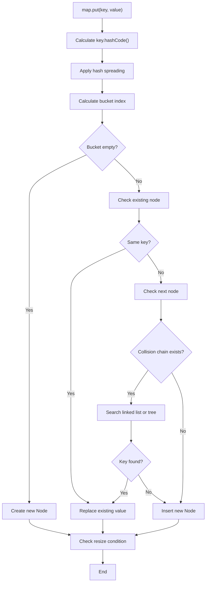

## 3. How HashMap calculates the bucket index

This is one of the most important interview questions.

HashMap uses the following formula:

```
index = (n-1) & hash
```
Where:

- `n` = capacity of the HashMap.
- `hash` = spread hash of the key.
- `&` = bitwise AND operator.

Hash spreading in modern Java implementations:

java

```java
static final int hash(Object key) {
    int h;
    return (key == null) ? 0 :
           (h = key.hashCode()) ^ (h >>> 16);
}
```

Why does HashMap use `h ^ (h >>> 16)`?

It combines higher-order bits with lower-order bits to help distribute hash values across buckets.

### Example

Suppose:

java

```java
int hash = 10;
int capacity = 16;

int index = (capacity - 1) & hash;

System.out.println(index);
```

Output:

text

```text
10
```

Because:

text

```text
Capacity = 16
n - 1    = 15

15 & 10 = 10
```

## 4. How HashMap handles collisions

A collision occurs when two different keys get the same bucket index.

Example:

java

```java
map.put(1, "Java");
map.put(17, "Python");
```

Assuming the capacity is 16 and the spread hashes are 1 and 17:

```
(16-1) & 1 = 1

(16-1) & 17 = 1
```

Both elements go into bucket 1.

### Mermaid diagram – Collision handling

mermaid

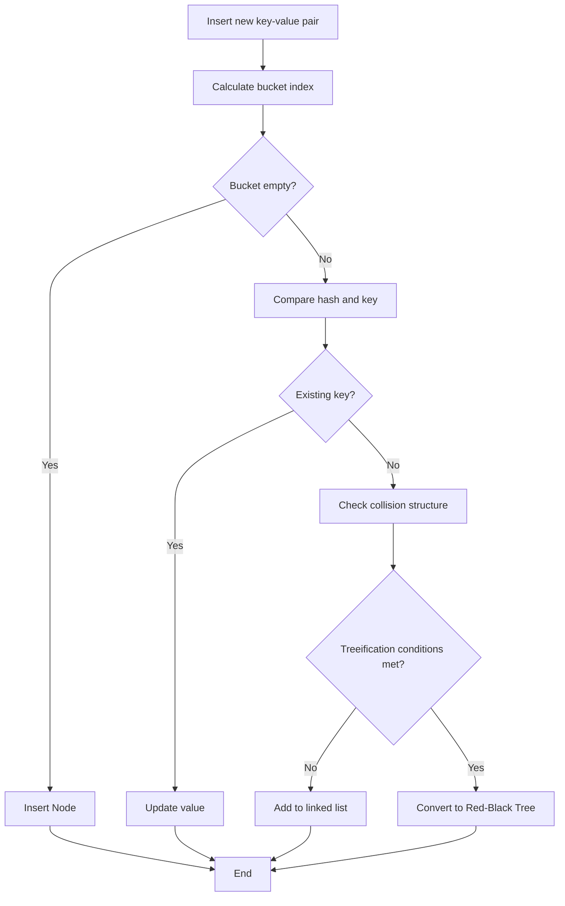

### LinkedList representation

Bucket 1

1

Java

17

Python

33

Spring

null

All three keys are stored in the same bucket because they produce the same bucket index.

## 5. When does HashMap convert LinkedList into Red-Black Tree?

Java 8 introduced treeification to improve performance when too many collisions occur in one bucket.

Important constants in HashMap:

java

```java
static final int DEFAULT_INITIAL_CAPACITY = 16;

static final float DEFAULT_LOAD_FACTOR = 0.75f;

static final int TREEIFY_THRESHOLD = 8;

static final int UNTREEIFY_THRESHOLD = 6;

static final int MIN_TREEIFY_CAPACITY = 64;
```

| Constant | Value | Meaning |
| --- | --- | --- |
| Initial capacity | 16 | Default bucket array size |
| Load factor | 0.75 | Resize threshold factor |
| Treeify threshold | 8 | Collision threshold for treeification |
| Untreeify threshold | 6 | Threshold used when converting a tree back to a list during resizing |
| Minimum treeify capacity | 64 | Minimum capacity for treeification |

Important interview point:

When a bucket has at least 8 nodes, HashMap may attempt treeification. However, if the table capacity is less than 64, HashMap resizes instead of converting the bucket into a tree.

The exact treeification decision depends on the insertion and resize logic.

### Mermaid diagram – Treeification

mermaid

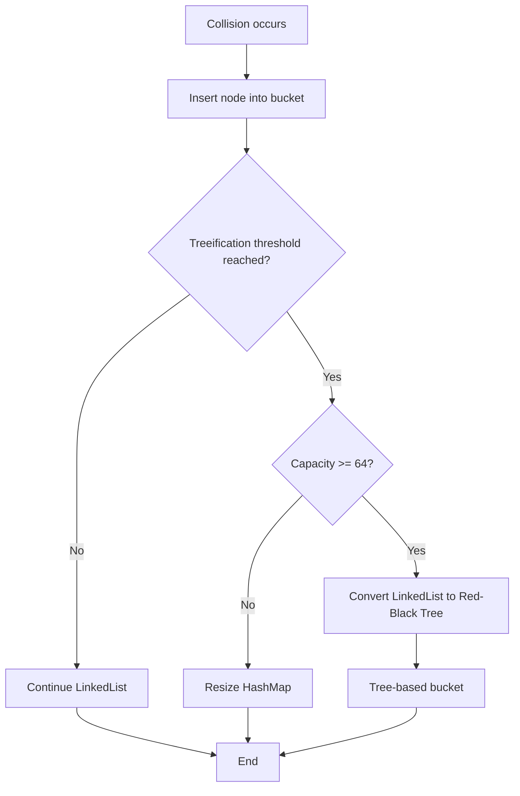

🧠 How HashMap Works Internally After Java 8 (With Visual Diagrams) | by Priyaranjanpatra | Medium

[medium.com](<https://medium.com/%40priyaranjanpatraa/how-hashmap-works-internally-after-java-8-with-visual-diagrams-cba0725de9e8?utm_source=chatgpt.com>)

## 6. How HashMap retrieves elements – get() method

Suppose:

java

```java
map.put(1, "Java");
map.put(2, "Python");

System.out.println(map.get(1));
```

Internal working:

1. Calculate the hash of the key.
2. Calculate the bucket index.
3. Go to the corresponding bucket.
4. Compare the hash and key.
5. If the key is found, return its value.
6. Otherwise, search the linked list or tree.
7. If not found, return `null`.

### Mermaid diagram – get() operation

mermaid

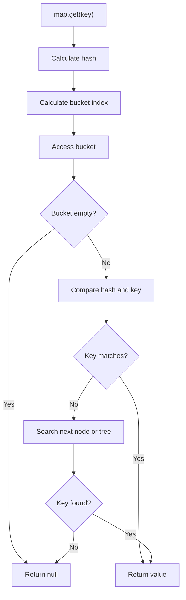

## 7. How HashMap resizes internally

Default capacity = 16.

Default load factor = 0.75.

The resize threshold is:

```
16 * 0.75 = 12
```
When the number of entries exceeds the threshold, HashMap generally resizes its bucket array.

New capacity:

```
16 * 2 = 32
```

### Example

java

```java
HashMap<Integer, String> map = new HashMap<>();

for (int i = 1; i <= 13; i++) {
    map.put(i, "Value" + i);
}
```

The table is allocated lazily on first insertion. With the default settings, insertion of the 13th distinct entry causes the resize from capacity 16 to 32, assuming no prior changes.

### Mermaid diagram – Resize operation

mermaid

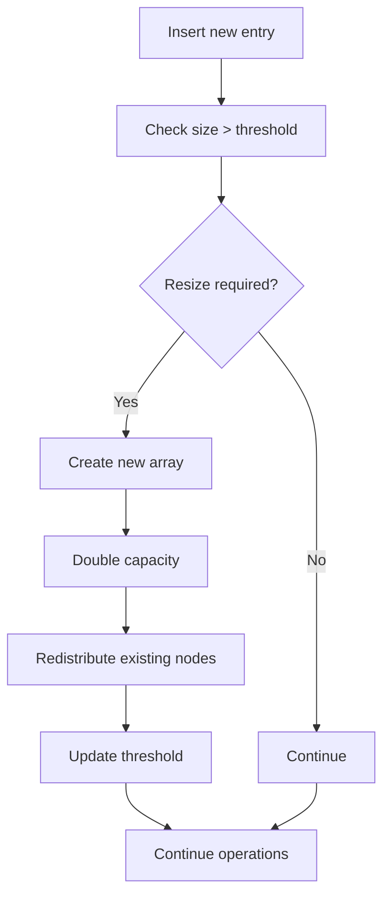

## 8. HashMap internal architecture – Complete overview

This diagram connects all the major internal operations.

mermaid

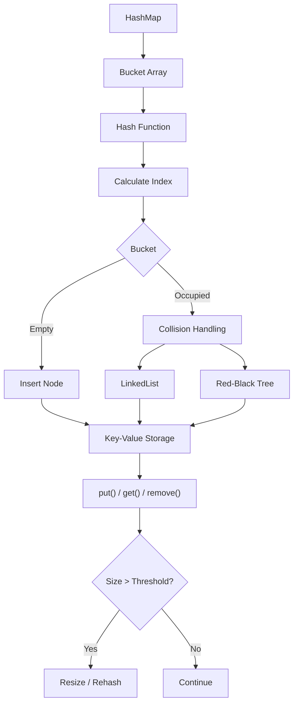

## 9. Time complexity of HashMap

| Operation | Average case | Worst case |
| --- | --- | --- |
| `put()` | O(1) | O(n), generally; O(log n) for tree bins under suitable key conditions |
| `get()` | O(1) | O(n), generally; O(log n) for tree bins under suitable key conditions |
| `remove()` | O(1) | O(n), generally; O(log n) for tree bins under suitable key conditions |
| `containsKey()` | O(1) | O(n), generally; O(log n) for tree bins under suitable key conditions |

Tree-bin operations are typically O(log n), but their worst-case behavior can depend on hash distribution and key comparison characteristics.

## 10. Important HashMap interview questions

| Interview question | Key answer |
| --- | --- |
| Can HashMap store null keys? | Yes, one null key |
| Can HashMap store null values? | Yes, multiple null values |
| Is HashMap thread-safe? | No |
| What is default capacity? | 16 |
| What is default load factor? | 0.75 |
| What is collision? | Different keys mapping to the same bucket |
| How are collisions handled? | LinkedList and Red-Black Tree |
| When does treeification happen? | Around 8 nodes, subject to capacity conditions |
| What is minimum treeify capacity? | 64 |
| What happens during resizing? | Bucket array capacity doubles |
| Does HashMap maintain insertion order? | No |
| Which method calculates hash? | `hashCode()` |
| Which method checks key equality? | `equals()` |

## 11. Complete internal working – Remember this flow

1. put(key, value)
   Insert a key-value pair.
2. hashCode()
   Generate the key's hash code.
3. Hash spreading
   Mix higher bits with lower bits.
4. Bucket index calculation
   `(n - 1) & hash`
5. Collision handling
   Use LinkedList or Red-Black Tree.
6. Resize
   Double capacity when the threshold is exceeded.
7. get(key)
   Find the bucket and retrieve the value.

Interview tipThe most frequently asked HashMap internal working questions are:

1. How does HashMap work internally?
2. How does HashMap calculate the bucket index?
3. How does HashMap handle collisions?
4. Why does HashMap use a Red-Black Tree?
5. What happens when two keys have the same hash code?
6. What happens if two keys have the same hash code but are not equal?
7. How does HashMap resize?
8. Why should we override both `equals()` and `hashCode()`?

Remember this one-line answer for interviews:

HashMap internally uses an array of buckets, calculates a hash using `hashCode()`, determines the bucket index using `(n - 1) & hash`, handles collisions using linked lists or Red-Black Trees, and resizes when its size exceeds the threshold.

---
# HashMap Internals – 8 Important Java Interview Questions and Answers

Here are detailed interview-ready answers with examples and internal explanations.

## 1. How does HashMap work internally in Java?

Answer:

HashMap stores data in key-value pairs. Internally, it uses an array of buckets, where each bucket stores a Node object.

Each Node contains:

- `hash` – hash value of the key.
- `key` – actual key.
- `value` – associated value.
- `next` – reference to the next node.

Internal working:

1. When we call `put(key, value)`, HashMap calculates the key's hash code.
2. It applies a hash-spreading function.
3. It calculates the bucket index.
4. If the bucket is empty, it inserts a new node.
5. If the bucket is occupied, it checks for a collision.
6. If the key already exists, it updates the value.
7. Otherwise, it adds a new node to the bucket's linked list or tree.
8. If the size exceeds the threshold, HashMap resizes.

Example:

java

```java
HashMap<Integer, String> map = new HashMap<>();

map.put(1, "Java");
map.put(2, "Python");
map.put(3, "Spring");

System.out.println(map.get(1));
```

Output:

text

```text
Java
```

Interview one-line answer: HashMap uses an array of buckets and handles collisions using LinkedList or Red-Black Tree.

## 2\. How does HashMap calculate the bucket index?

Answer:

HashMap calculates the bucket index using the following formula:

```
index = (n-1) & hash
```

Where:

- `n` = current capacity of HashMap.
- `hash` = spread hash value.
- `&` = bitwise AND operator.

HashMap first calculates the spread hash:

java

```java
static final int hash(Object key) {
    int h;
    return (key == null) ? 0 :
        (h = key.hashCode()) ^ (h >>> 16);
}
```

Example:

java

```java
int capacity = 16;
int hash = 10;

int index = (capacity - 1) & hash;

System.out.println(index);
```

Output:

text

```text
10
```

Explanation:

text

```text
Capacity = 16

n - 1 = 15

15 in binary = 1111
10 in binary = 1010

1111
1010
----
1010 = 10
```

Why does HashMap use bitwise AND?

It is efficient and works correctly because HashMap capacities are powers of two.

## 3\. How does HashMap handle collisions?

Answer:

A collision occurs when two different keys generate the same bucket index.

Example:

java

```java
HashMap<Integer, String> map = new HashMap<>();

map.put(1, "Java");
map.put(17, "Python");
```

Assuming the capacity is 16 and the spread hashes are 1 and 17:

text

```text
Index of 1  = 15 & 1  = 1
Index of 17 = 15 & 17 = 1
```

Both keys are stored in bucket 1.

HashMap handles collisions using:

1. LinkedList
2. Red-Black Tree

Internal representation:

Bucket 1

1

Java

17

Python

null

Collision nodes are connected through the next reference.

If the bucket becomes sufficiently crowded and capacity conditions are met, HashMap converts the linked list into a Red-Black Tree.

## 4\. Why does HashMap use Red-Black Tree?

Answer:

HashMap uses a Red-Black Tree to improve searching performance when many keys are stored in the same bucket.

Before treeification:

- Collision nodes are stored in a linked list.
- Searching may take O(n) time.

After treeification:

- Nodes are organized as a balanced Red-Black Tree.
- Searching generally takes O(log n) time.

Important constants:

java

```java
TREEIFY_THRESHOLD = 8;
UNTREEIFY_THRESHOLD = 6;
MIN_TREEIFY_CAPACITY = 64;
```

Important conditions:

- When a bucket reaches the treeification threshold, HashMap may attempt treeification.
- If the table capacity is less than 64, HashMap resizes instead of treeifying.
- During resizing, a tree bin can be converted back into a linked list when its node count becomes sufficiently small.

Interview one-line answer: Red-Black Trees improve collision-heavy bucket operations from linear searching to logarithmic searching under normal tree-bin conditions.

## 5\. What happens when two keys have the same hashCode but are not equal?

Answer:

If two keys have the same hash code but are not equal, HashMap stores both keys in the same bucket as separate entries.

HashMap uses:

- `hashCode()` to identify the bucket.
- `equals()` to check whether keys are logically equal.

Example:

java

```java
import java.util.*;

class Employee {
    int id;

    Employee(int id) {
        this.id = id;
    }

    @Override
    public int hashCode() {
        return 10;
    }

    @Override
    public boolean equals(Object obj) {
        if (this == obj) return true;

        if (!(obj instanceof Employee)) return false;

        Employee e = (Employee) obj;
        return this.id == e.id;
    }
}

public class Main {
    public static void main(String[] args) {

        HashMap<Employee, String> map =
                new HashMap<>();

        Employee e1 = new Employee(1);
        Employee e2 = new Employee(2);

        map.put(e1, "Java");
        map.put(e2, "Python");

        System.out.println(map.size());
    }
}
```

Output:

text

```text
2
```

Both objects have the same hash code, but their IDs differ, so they are not equal.

Interview one-line answer: Same hash code does not mean same key. HashMap uses `equals()` to distinguish keys within a bucket.

## 6\. How does HashMap resize internally?

Answer:

HashMap resizes when the number of entries exceeds its threshold.

Formula:

```
Threshold = Capacity * LoadFactor
```

Default values:

- Initial capacity = 16.
- Load factor = 0.75.
- Threshold = 16 × 0.75 = 12.

When the number of entries exceeds 12, HashMap generally increases its capacity to 32.

Example:

java

```java
HashMap<Integer, String> map = new HashMap<>();

for (int i = 1; i <= 13; i++) {
    map.put(i, "Value" + i);
}
```

Internal resizing:

text

```text
Before resize:

Capacity = 16
Threshold = 12

After 13th distinct insertion:

Capacity = 32
Threshold = 24
```

How resizing works:

1. Creates a larger bucket array.
2. Redistributes existing entries into the new array.
3. Updates the threshold.

Modern HashMap implementations optimize redistribution using the old capacity bit, rather than recalculating every hash from scratch.

## 7\. Why should we override both equals() and hashCode()?

Answer:

When we use custom objects as HashMap keys, we should correctly override both `equals()` and `hashCode()`.

The Java contract states:

- If two objects are equal according to `equals()`, they must have the same hash code.
- If two objects have the same hash code, they do not necessarily need to be equal.

Example:

java

```java
import java.util.*;

class Student {
    int id;

    Student(int id) {
        this.id = id;
    }

    @Override
    public int hashCode() {
        return Objects.hash(id);
    }

    @Override
    public boolean equals(Object obj) {

        if (this == obj) return true;

        if (!(obj instanceof Student)) return false;

        Student s = (Student) obj;

        return this.id == s.id;
    }
}

public class Main {
    public static void main(String[] args) {

        HashMap<Student, String> map =
                new HashMap<>();

        Student s1 = new Student(101);
        Student s2 = new Student(101);

        map.put(s1, "Java");

        System.out.println(map.get(s2));
    }
}
```

Output:

text

```text
Java
```

Although `s1` and `s2` are different objects, they are logically equal because their IDs are the same.

Interview one-line answer: Overriding both methods ensures that logically equal objects are stored and retrieved correctly as HashMap keys.

## 8\. Is HashMap thread-safe? How can we make it thread-safe?

Answer:

No, HashMap is not thread-safe.

When multiple threads access and modify a HashMap simultaneously, external synchronization may be required to prevent data races and inconsistent operations.

There are three common approaches:

Approach 1: Collections.synchronizedMap()

java

```java
Map<Integer, String> map =
    Collections.synchronizedMap(new HashMap<>());

map.put(1, "Java");
map.put(2, "Python");
```

Approach 2: ConcurrentHashMap

java

```java
ConcurrentHashMap<Integer, String> map =
    new ConcurrentHashMap<>();

map.put(1, "Java");
map.put(2, "Python");
```

Approach 3: Hashtable

java

```java
Hashtable<Integer, String> map =
    new Hashtable<>();

map.put(1, "Java");
map.put(2, "Python");
```

Comparison:

| Feature | HashMap | Hashtable | ConcurrentHashMap |
| --- | --- | --- | --- |
| Thread-safe | No | Yes | Yes |
| Null key | Yes | No | No |
| Null values | Yes | No | No |
| Synchronization | None by default | Synchronized methods | Fine-grained concurrency |
| Performance under concurrency | Requires external coordination | Often less scalable | Generally more scalable |

Interview recommendation: Prefer ConcurrentHashMap for most concurrent map use cases.

## 9. Bonus: HashMap internal working – Complete Mermaid diagram

This is the complete flow you can explain in a Java interview.

mermaid

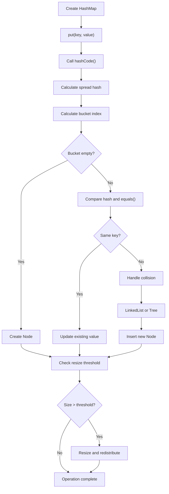

## 10\. Quick interview revision

| Question | Answer |
| --- | --- |
| Default capacity? | 16 |
| Default load factor? | 0.75 |
| Default threshold? | 12 |
| Bucket index formula? | `(n - 1) & hash` |
| Collision handling? | LinkedList / Red-Black Tree |
| Treeify threshold? | 8 |
| Minimum treeify capacity? | 64 |
| Resize capacity? | Doubles |
| Null keys allowed? | Yes, one |
| Null values allowed? | Yes, multiple |
| Thread-safe? | No |
| Key comparison? | `hashCode()` and `equals()` |

Important interview tip: Be prepared to explain these three topics with code and diagrams:

1. `put()` and `get()` internal working.
2. Collision handling and Red-Black Tree conversion.
3. `hashCode()` and `equals()` contract.

These are the core concepts behind Java HashMap internals.

---
# ConcurrentHashMap Internals in Java (With Mermaid Diagrams)

`ConcurrentHashMap` is a thread-safe Map implementation available in the `java.util.concurrent` package.

It allows multiple threads to read and update map entries concurrently without locking the entire map for every operation.

It is commonly used in multithreaded applications, banking systems, caching, and backend applications.

## 1. Internal structure of ConcurrentHashMap

In Java 8 and later, ConcurrentHashMap internally uses:

1. Array of buckets (Node array).
2. LinkedList for collision handling.
3. Red-Black Tree for heavily collided buckets.
4. CAS (Compare-And-Swap) operations.
5. `synchronized` blocks for coordinating certain bucket updates.
6. Volatile fields for memory visibility.

Internal Node structure (simplified):

java

```java
static class Node<K,V> {
    final int hash;
    final K key;
    volatile V val;
    volatile Node<K,V> next;
}
```

Java 8 ConcurrentHashMap Internals: How CAS Killed Segment Locks | by Gaddam.Naveen | Medium

[medium.com](<https://medium.com/%40gaddamnaveen192/java-8-concurrenthashmap-internals-how-cas-killed-segment-locks-652227349d25?utm_source=chatgpt.com>)

Unlike older Java 7 implementations, Java 8 and later do not use the fixed Segment-based locking architecture.

## 2. How ConcurrentHashMap works internally – put() method

Example:

java

```java
ConcurrentHashMap<Integer, String> map =
        new ConcurrentHashMap<>();

map.put(1, "Java");
map.put(2, "Python");
map.put(3, "Spring");
```

### Internal working

1. Calculate the hash code of the key.
2. Apply hash spreading.
3. Calculate the bucket index.
4. Check whether the bucket is empty.
5. If empty, try inserting using CAS.
6. If occupied, synchronize on the bucket's first node when needed.
7. Check whether the key already exists.
8. If the key exists, update its value.
9. Otherwise, add a new node.
10. If collisions increase, convert the linked list into a Red-Black Tree when conditions are met.

### Mermaid diagram – put() operation

mermaid

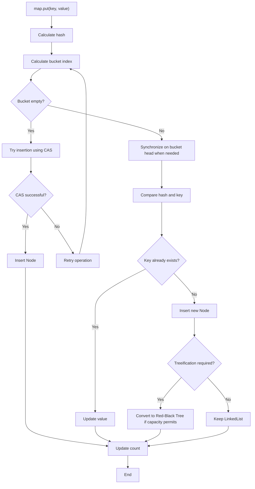

## 3. What is CAS in ConcurrentHashMap?

CAS stands for Compare-And-Swap.

It is a lock-free atomic operation used to update a variable safely.

It checks whether the current value is equal to the expected value.

- If equal, it updates the value.
- If not equal, the update fails.

### Example concept

Suppose a bucket is empty.

Initially:

text

```text
Bucket = null
```

Thread 1 wants to insert Java.

Thread 2 wants to insert Python.

Both threads try to insert simultaneously.

mermaid

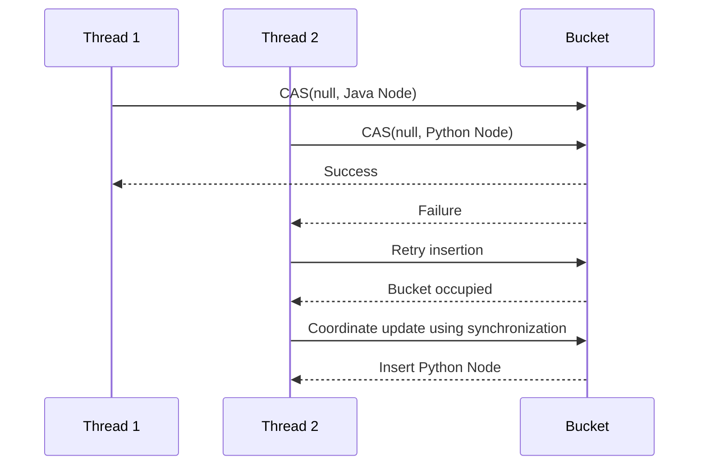

Important: CAS does not lock the bucket. It atomically changes the bucket reference only if the expected value matches.

## 4. How ConcurrentHashMap handles collisions

ConcurrentHashMap handles collisions similarly to Java 8 HashMap.

It uses:

- LinkedList
- Red-Black Tree

Example:

java

```java
ConcurrentHashMap<Integer, String> map =
        new ConcurrentHashMap<>();

map.put(1, "Java");
map.put(17, "Python");
map.put(33, "Spring");
```

Assuming the initial capacity is 16 and the spread hashes are 1, 17, and 33, all three entries map to bucket 1.

Bucket 1

1

Java

17

Python

33

Spring

Colliding entries are stored in the same bucket.

Important constants in Java 8+ implementations:

java

```java
TREEIFY_THRESHOLD = 8;
UNTREEIFY_THRESHOLD = 6;
MIN_TREEIFY_CAPACITY = 64;
```

As with HashMap, treeification depends on insertion and capacity conditions.

## 5. How ConcurrentHashMap retrieves elements – get()

Example:

java

```java
ConcurrentHashMap<Integer, String> map =
        new ConcurrentHashMap<>();

map.put(1, "Java");
map.put(2, "Python");

System.out.println(map.get(1));
```

Internal working:

1. Calculate hash.
2. Calculate bucket index.
3. Access the corresponding bucket.
4. Compare hash and key.
5. If found, return the value.
6. Otherwise, search the linked list or tree.
7. If not found, return null.

### Mermaid diagram – get() operation

mermaid

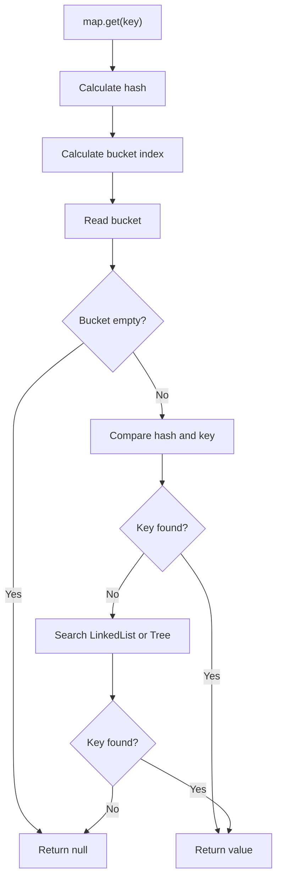

Interview point: ConcurrentHashMap's get() operation generally does not require locking. It uses volatile reads and appropriate memory visibility mechanisms.

## 6. How ConcurrentHashMap resizes internally

ConcurrentHashMap increases its capacity when the number of elements exceeds its resize threshold.

Unlike a simple single-threaded HashMap resize, ConcurrentHashMap supports multiple threads participating in the transfer of entries to a new table.

It uses an internal mechanism called ForwardingNode to coordinate this transfer.

### Mermaid diagram – Resize operation

mermaid

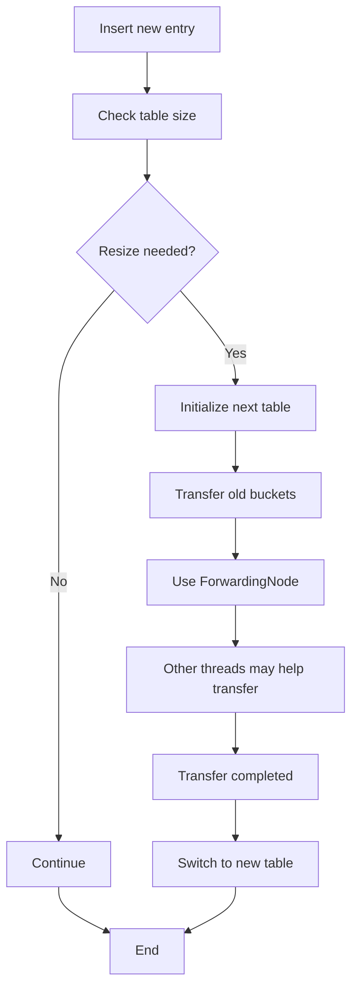

What is ForwardingNode?

It is a special internal node that indicates a bucket has been transferred to the new table.

When another thread encounters it, it can recognize that resizing is in progress and help with the transfer.

## 7. How ConcurrentHashMap achieves thread safety

ConcurrentHashMap uses multiple techniques:

| Mechanism | Purpose |
| --- | --- |
| CAS | Atomically inserts nodes into empty buckets |
| `synchronized` | Coordinates updates to occupied buckets |
| `volatile` | Ensures visibility of shared data |
| ForwardingNode | Coordinates concurrent resizing |
| Fine-grained synchronization | Avoids locking the entire map for every update |

Important interview point:

ConcurrentHashMap does not lock the entire map for every operation. Different buckets can generally be updated concurrently.

## 8. HashMap vs ConcurrentHashMap

This is one of the most frequently asked Java interview questions.

| Feature | HashMap | ConcurrentHashMap |
| --- | --- | --- |
| Thread safety | Not thread-safe | Thread-safe |
| Package | `java.util` | `java.util.concurrent` |
| Null key | Allows one | Not allowed |
| Null values | Allowed | Not allowed |
| Internal structure | Array, LinkedList, Tree | Array, LinkedList, Tree |
| CAS | Not used for normal operations | Used |
| Synchronization | No built-in synchronization | Fine-grained coordination |
| Iterator | Fail-fast | Weakly consistent |
| Concurrent reads | No built-in concurrency guarantees | Supported |
| Concurrent writes | Requires external coordination | Supported |

## 9. ConcurrentHashMap vs Hashtable

| Feature | ConcurrentHashMap | Hashtable |
| --- | --- | --- |
| Thread-safe | Yes | Yes |
| Synchronization | Fine-grained | Synchronized methods |
| Null key | Not allowed | Not allowed |
| Null values | Not allowed | Not allowed |
| Performance under concurrency | Generally better | Often less scalable |
| Iterator | Weakly consistent | Enumerations are not fail-fast; iterators are fail-fast |

Interview answer: ConcurrentHashMap generally provides better concurrency because it does not synchronize every operation on the entire map.

## 10. Important ConcurrentHashMap methods

| Method | Description |
| --- | --- |
| `put(K key, V value)` | Inserts or updates an entry |
| `get(Object key)` | Retrieves a value |
| `remove(Object key)` | Removes an entry |
| `putIfAbsent(K key, V value)` | Inserts only if the key is absent |
| `replace(K key, V value)` | Replaces an existing value |
| `containsKey(Object key)` | Checks whether a key exists |
| `containsValue(Object value)` | Checks whether a value exists |
| `compute(K key, BiFunction)` | Computes a value for a key |
| `computeIfAbsent(K key, Function)` | Computes a value only when absent |
| `computeIfPresent(K key, BiFunction)` | Computes a value only when present |
| `merge(K key, V value, BiFunction)` | Combines an existing value with a supplied value |
| `forEach(BiConsumer)` | Performs an action for each entry |

### Example using putIfAbsent()

java

```java
ConcurrentHashMap<Integer, String> map =
        new ConcurrentHashMap<>();

map.put(1, "Java");

map.putIfAbsent(1, "Python");
map.putIfAbsent(2, "Spring");

System.out.println(map);
```

Output:

text

```text
{1=Java, 2=Spring}
```

### Example using computeIfAbsent()

java

```java
ConcurrentHashMap<Integer, String> map =
        new ConcurrentHashMap<>();

map.put(1, "Java");

map.computeIfAbsent(2, key -> "Python");

System.out.println(map);
```

Output:

text

```text
{1=Java, 2=Python}
```

## 11. Complete ConcurrentHashMap internal architecture

mermaid

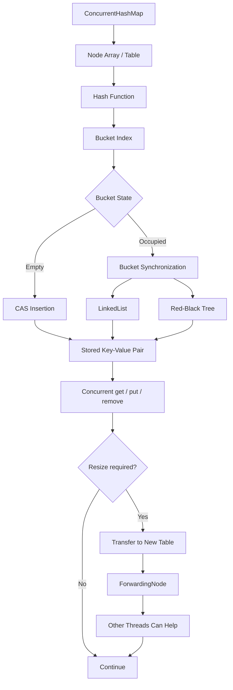

## 12. Important ConcurrentHashMap interview questions and answers

Q1. Is ConcurrentHashMap thread-safe?

Yes. It supports concurrent access and modification through CAS, volatile operations, and fine-grained synchronization.

Q2. Can ConcurrentHashMap store null keys?

No. It does not allow null keys.

Q3. Can ConcurrentHashMap store null values?

No. It does not allow null values.

Q4. Does ConcurrentHashMap use Segment locking?

Not in Java 8 and later. It uses bucket-level coordination, CAS, and other concurrency mechanisms.

Q5. Is get() synchronized?

No. The normal get() operation does not acquire a lock.

Q6. What is CAS?

Compare-And-Swap is an atomic operation that updates a value only if its current value matches the expected value.

Q7. What is ForwardingNode?

A special internal node used during resizing to indicate that a bucket has been transferred to a new table.

Q8. Does ConcurrentHashMap allow duplicate keys?

No. Keys must be unique. Adding an existing key updates its value.

Q9. What is a weakly consistent iterator?

An iterator that can tolerate concurrent modifications and does not throw `ConcurrentModificationException` because of those modifications. It may reflect some changes made during iteration.

Q10. Can multiple threads update different buckets simultaneously?

Yes. Fine-grained synchronization allows updates to different buckets to proceed concurrently in normal circumstances.

## 13. HashMap vs ConcurrentHashMap – Internal architecture comparison

HashMap

How HashMap Works Internally?. Principle of Hashing | by Ramjeet Mahto | Medium

No built-in thread safety. No CAS for normal operations.

ConcurrentHashMap

Concurrency-Safe Does Not Mean Logic-Safe | by Ankit Kumar Srivastava | Jan, 2026 | Medium

CAS, volatile operations and fine-grained synchronization.

## 14. Most important points to remember for interviews

| Topic | HashMap | ConcurrentHashMap |
| --- | --- | --- |
| Default initial capacity | 16 | 16 |
| Default load factor | 0.75 | 0.75 |
| Collision handling | LinkedList / Tree | LinkedList / Tree |
| Treeify threshold | 8 | 8 |
| Minimum treeify capacity | 64 | 64 |
| Thread safety | No | Yes |
| Null keys | One allowed | Not allowed |
| Null values | Allowed | Not allowed |
| Internal CAS | No | Yes |
| Whole-map locking | No | No |

These are Java 8+ implementation details; internal implementation is not part of the general Map interface contract.

Most important interview answerHow does ConcurrentHashMap work internally?

ConcurrentHashMap internally uses an array of buckets. It calculates the hash of a key to identify the bucket. If the bucket is empty, it uses CAS to insert a new node. If the bucket is occupied, it uses synchronization on the bucket's first node to coordinate updates. Collisions are handled using linked lists or Red-Black Trees. It uses volatile operations for visibility and supports concurrent resizing using ForwardingNodes. Unlike HashMap, it is designed to support multiple threads accessing and modifying the map safely.

Next important topic to study: `ConcurrentHashMap vs synchronizedMap vs Hashtable`, especially their internal locking mechanisms and performance differences.

---
# ConcurrentHashMap vs synchronizedMap vs Hashtable in Java

This is a very important Java multithreading interview topic. All three provide thread-safe Map operations, but their internal synchronization mechanisms are different.

## 1. Basic introduction

### A. HashMap

- Not thread-safe.
- Multiple threads can access it, but concurrent modifications require external synchronization.
- Allows one null key and multiple null values.

java

```java
Map<Integer, String> map = new HashMap<>();
```

### B. synchronizedMap()

- A thread-safe wrapper around an existing Map.
- Uses synchronization to protect Map operations.
- Locks the wrapper for synchronized operations.

java

```java
Map<Integer, String> map =
    Collections.synchronizedMap(new HashMap<>());
```

### C. Hashtable

- Legacy thread-safe Map implementation.
- Its methods are synchronized.
- Uses synchronization on the Hashtable instance.
- Does not allow null keys or null values.

java

```java
Map<Integer, String> map = new Hashtable<>();
```

### D. ConcurrentHashMap

- Designed for high-concurrency applications.
- Uses CAS and fine-grained synchronization.
- Does not lock the entire map for every update.
- Does not allow null keys or values.

java

```java
Map<Integer, String> map =
    new ConcurrentHashMap<>();
```

## 2. Internal architecture comparison

1. synchronizedMap()

Thread 1

Thread 2

Single wrapper lock

Only one thread at a time can execute synchronized wrapper operations

Underlying HashMap

2. Hashtable

Multiple Threads

Hashtable instance lock

Synchronized methods coordinate access to the same Hashtable

Hashtable internal table

3. ConcurrentHashMap

Multiple Threads

CAS

Lock A

Lock B

ConcurrentHashMap buckets

Independent bucket updates can proceed concurrently

## 3. Mermaid diagram – synchronizedMap internal working

mermaid

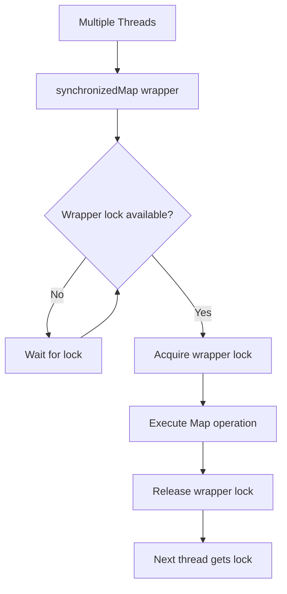

Explanation: The wrapper synchronizes individual Map operations using its common mutex. A compound operation involving multiple calls must be synchronized externally.

## 4. Mermaid diagram – Hashtable internal working

mermaid

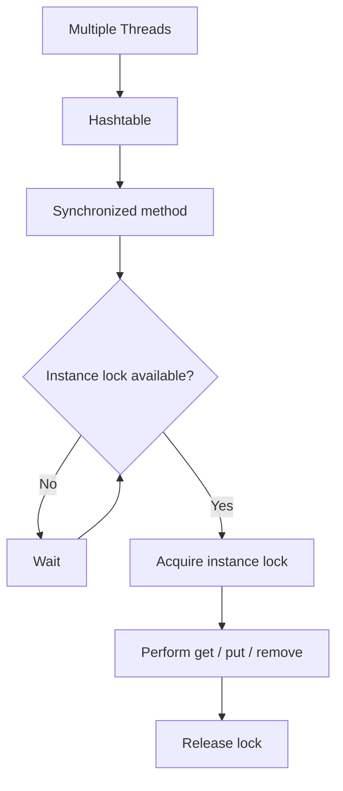

Explanation: Hashtable synchronizes its methods using the Hashtable instance monitor. This can limit concurrency between operations on the same instance.

## 5. Mermaid diagram – ConcurrentHashMap internal working

mermaid

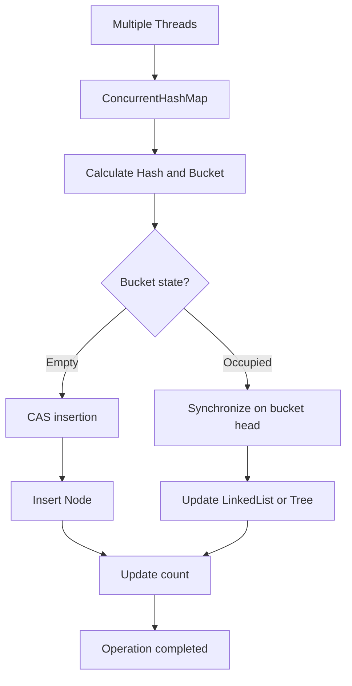

Explanation: ConcurrentHashMap allows different threads to work on different buckets concurrently, using CAS for empty buckets and fine-grained synchronization for occupied buckets.

## 6. Complete comparison table

| Feature | HashMap | synchronizedMap | Hashtable | ConcurrentHashMap |
| --- | --- | --- | --- | --- |
| Thread-safe | No | Yes | Yes | Yes |
| Synchronization | None | Wrapper mutex | Instance monitor | Fine-grained |
| Null key | Yes | Depends on backing Map | No | No |
| Null values | Yes | Depends on backing Map | No | No |
| Concurrent reads | No built-in guarantee | Serialized through wrapper | Serialized through instance | Supported |
| Concurrent writes | No built-in guarantee | Serialized through wrapper | Serialized through instance | Supported |
| Iterator | Fail-fast | Backing iterator; external locking needed | Fail-fast iterator | Weakly consistent |
| Performance under concurrency | Requires external coordination | Limited by common lock | Limited by common lock | Generally better |
| Package | `java.util` | `java.util` | `java.util` | `java.util.concurrent` |

## 7. Complete Java example

Let's see how to create all three thread-safe Maps.

java

```java

import java.util.*;
import java.util.concurrent.*;

public class MapExample {

    public static void main(String[] args) {

        // 1. HashMap
        Map<Integer, String> map1 =
                new HashMap<>();

        map1.put(1, "Java");

        // 2. SynchronizedMap
        Map<Integer, String> map2 =
                Collections.synchronizedMap(
                        new HashMap<>()
                );

        map2.put(1, "Java");

        // 3. Hashtable
        Map<Integer, String> map3 =
                new Hashtable<>();

        map3.put(1, "Java");

        // 4. ConcurrentHashMap
        Map<Integer, String> map4 =
                new ConcurrentHashMap<>();

        map4.put(1, "Java");

        System.out.println(map1);
        System.out.println(map2);
        System.out.println(map3);
        System.out.println(map4);
    }
}
```

Output:

text

```text
{1=Java}
{1=Java}
{1=Java}
{1=Java}
```

## 8. Important interview questions and answers

### Q1. Why is ConcurrentHashMap faster than Hashtable?

ConcurrentHashMap supports concurrent operations using fine-grained synchronization and CAS. Hashtable synchronizes its methods on the entire instance, which can create more thread contention.

### Q2. Why is synchronizedMap better than Hashtable?

`Collections.synchronizedMap()` can wrap different Map implementations, such as HashMap or TreeMap. It provides a synchronized wrapper rather than requiring the legacy Hashtable class.

### Q3. Can synchronizedMap allow null keys?

It depends on the underlying Map.

java

```java
Map<Integer, String> map =
    Collections.synchronizedMap(new HashMap<>());

map.put(null, "Java"); // Allowed
```

But:

java

```java
Map<Integer, String> map =
    Collections.synchronizedMap(new Hashtable<>());

map.put(null, "Java"); // NullPointerException
```

### Q4. Is ConcurrentHashMap completely lock-free?

No. It uses CAS for certain operations, but it also uses synchronized blocks for updates to occupied buckets and other coordination mechanisms.

### Q5. Can two threads read and write ConcurrentHashMap simultaneously?

Yes. ConcurrentHashMap supports concurrent reads and updates. Its design allows operations to overlap safely, although particular operations can still contend on the same bucket.

### Q6. Is synchronizedMap iterator thread-safe?

The wrapper makes individual Map methods synchronized, but iteration requires external synchronization.

Correct example:

java

```java
Map<Integer, String> map =
    Collections.synchronizedMap(new HashMap<>());

map.put(1, "Java");
map.put(2, "Python");

synchronized (map) {
    for (Map.Entry<Integer, String> entry
            : map.entrySet()) {

        System.out.println(
            entry.getKey() + " " + entry.getValue()
        );
    }
}
```

### Q7. Does ConcurrentHashMap iterator require synchronization?

No. Its iterators are weakly consistent and designed to tolerate concurrent modifications.

java

```java
ConcurrentHashMap<Integer, String> map =
        new ConcurrentHashMap<>();

map.put(1, "Java");
map.put(2, "Python");

for (Map.Entry<Integer, String> entry
        : map.entrySet()) {

    System.out.println(entry);
}
```

### Q8. Which Map should we use in real-time applications?

- `HashMap`: Single-threaded use or externally coordinated access.
- `synchronizedMap`: Simple thread-safe wrapper when a common lock is acceptable.
- `Hashtable`: Mostly legacy applications.
- `ConcurrentHashMap`: High-concurrency applications.

## 9. Test your interview knowledge

Try answering these five questions.

Java concurrency quiz

0/5 answered

1. Which Map uses CAS and fine-grained synchronization?

HashMap

Hashtable

ConcurrentHashMap

TreeMap

2. Can ConcurrentHashMap store null values?

Yes

No

Only one

Only with synchronization

3. Which Map synchronizes methods using the instance monitor?

HashMap

Hashtable

ConcurrentHashMap

TreeMap

4. Does synchronizedMap require external synchronization during iteration?

Yes

No

Only for HashMap

Never

5. Which is generally preferred for high-concurrency Map operations?

HashMap

Hashtable

ConcurrentHashMap

LinkedHashMap

Submit answers

My recommended next topic: Java `ExecutorService`, ThreadPoolExecutor, Callable, Future, CompletableFuture and thread pools. These build directly on the concurrent collection concepts and are particularly useful for Java backend interviews.

---
# CopyOnWriteArrayList in Java

`CopyOnWriteArrayList` is a thread-safe implementation of the List interface in Java.

It belongs to the `java.util.concurrent` package.

It is particularly useful in multithreaded applications where:

- Multiple threads frequently read data.
- Updates (add, remove, set) happen less frequently.
- You want to avoid `ConcurrentModificationException` during iteration.

## 1. How does CopyOnWriteArrayList work?

Whenever a thread modifies the list:

1. A new copy of the underlying array is created.
2. The modification is performed on the new array.
3. The new array replaces the old array.
4. Other threads reading the list can continue using the old array.

Java CopyOnWriteArrayList Tutorial with Examples | o7planning.org

[o7planning.org](<https://o7planning.org/13641/java-copyonwritearraylist?utm_source=chatgpt.com>)

Important: Read operations do not require locking, while write operations are synchronized.

## 2. Example

java

```java
import java.util.concurrent.CopyOnWriteArrayList;

public class Main {
    public static void main(String[] args) {

        CopyOnWriteArrayList<Integer> list =
                new CopyOnWriteArrayList<>();

        list.add(10);
        list.add(20);
        list.add(30);

        for (Integer num : list) {
            System.out.println(num);

            if (num == 20) {
                list.add(40);
            }
        }

        System.out.println(list);
    }
}
```

Output:

text

```text
10
20
30
[10, 20, 30, 40]
```

Notice:

- No `ConcurrentModificationException` occurs.
- The iterator sees the snapshot of the list taken when the iterator was created.
- The newly added element `40` is not visible to that iterator.

## 3. CopyOnWriteArrayList vs ArrayList vs Vector

| Feature | ArrayList | Vector | CopyOnWriteArrayList |
| --- | --- | --- | --- |
| Thread-safe | No | Yes | Yes |
| Read performance | Fast | Good | Very fast |
| Write performance | Fast | Slower | Slower |
| Synchronization | No | Synchronized methods | Lock-based writes |
| Iterator | Fail-fast | Fail-fast | Snapshot |
| Concurrent modification | May throw exception | May throw exception | No CME from iterator |

## 4. Important methods

java

```java
list.add(10);
list.remove(Integer.valueOf(10));
list.get(0);
list.set(0, 100);
list.contains(100);
list.size();
```

## 5. Advantages

- Thread-safe.
- No `ConcurrentModificationException` during iteration.
- Readers don't block writers.
- Iterators work on a consistent snapshot.
- Suitable for read-heavy applications.

## 6. Disadvantages

- Every write creates a new array.
- More memory consumption.
- Expensive for frequent updates.
- Not suitable for large lists with frequent modifications.

## 7. Real-world use cases

- Application configuration lists.
- Listener management.
- Event notification systems.
- Observer design pattern.
- Registered event handlers that are read frequently but modified rarely.

## 8. Interview questions

Q1. Why is it called CopyOnWriteArrayList?

Because every modification creates a new copy of the underlying array instead of modifying the existing array.

Q2. Does CopyOnWriteArrayList allow null values?

Yes, it allows null values.

Q3. Is CopyOnWriteArrayList completely lock-free?

No. Read operations are generally lock-free, but write operations use locking.

Q4. Does its iterator reflect newly added elements?

No. Its iterator uses a snapshot created when the iterator is initialized.

Q5. When should we use CopyOnWriteArrayList?

When read operations are frequent and write operations are rare.

Q6. Is it suitable for 10,000 writes per second?

Generally, no. Frequent writes cause repeated array copying, resulting in high memory allocation and performance overhead.

Interview tip: Remember this one-liner:

`CopyOnWriteArrayList = Thread-safe List + Snapshot Iterator + Copy on Every Write.`

---
# CopyOnWriteArraySet in Java

`CopyOnWriteArraySet` is a thread-safe implementation of the Set interface in Java.

It belongs to the `java.util.concurrent` package.

It internally uses a `CopyOnWriteArrayList` to store elements.

Main characteristics:

- Thread-safe.
- Does not allow duplicate elements.
- Allows null values.
- Iterators work on snapshots.
- Best suited for applications with frequent reads and infrequent writes.

## 1. How does CopyOnWriteArraySet work?

Internally, it uses a `CopyOnWriteArrayList`.

When we add an element:

1. It checks whether the element already exists.
2. If it exists, it does not add it.
3. If it does not exist, it creates a new copy of the underlying array.
4. It adds the new element to that copy.

Java CopyOnWriteArraySet Tutorial with Examples | o7planning.org

[o7planning.org](<https://o7planning.org/13609/java-copyonwritearrayset?utm_source=chatgpt.com>)

## 2. Example

java

```java
import java.util.concurrent.CopyOnWriteArraySet;

public class Main {
    public static void main(String[] args) {

        CopyOnWriteArraySet<Integer> set =
                new CopyOnWriteArraySet<>();

        set.add(10);
        set.add(20);
        set.add(30);
        set.add(20);

        System.out.println(set);

        for (Integer num : set) {
            System.out.println(num);

            if (num == 20) {
                set.add(40);
            }
        }

        System.out.println("Final Set: " + set);
    }
}
```

Output:

text

```text
[10, 20, 30]
10
20
30
Final Set: [10, 20, 30, 40]
```

Notice:

- Duplicate value `20` is not added.
- No `ConcurrentModificationException` occurs.
- Iterator does not see the newly added element `40`.

## 3. CopyOnWriteArraySet vs HashSet vs TreeSet

| Feature | HashSet | TreeSet | CopyOnWriteArraySet |
| --- | --- | --- | --- |
| Thread-safe | No | No | Yes |
| Duplicates | Not allowed | Not allowed | Not allowed |
| Null | One allowed | Generally not allowed | One allowed |
| Ordering | No guarantee | Sorted order | Insertion order |
| Iterator | Fail-fast | Fail-fast | Snapshot |
| Performance | Fast | O(log n) | Reads fast, writes expensive |

## 4. Important methods

java

```java
set.add(10);
set.remove(10);
set.contains(20);
set.size();
set.isEmpty();
set.clear();
```

## 5. Advantages

- Thread-safe collection.
- Prevents duplicate elements.
- No `ConcurrentModificationException` during iteration.
- Read operations are fast.
- Safe concurrent iteration using snapshots.

## 6. Disadvantages

- Every successful insertion requires copying the underlying array.
- Removing elements is expensive.
- Contains operations require linear searching.
- Not suitable for large collections with frequent modifications.

## 7. Real-world use cases

- Managing registered listeners.
- Maintaining a collection of unique event subscribers.
- Storing application configuration observers.
- Maintaining a list of unique registered services.
- Thread-safe collections of objects that rarely change.

## 8. CopyOnWriteArrayList vs CopyOnWriteArraySet

This is an important Java interview comparison.

| Feature | CopyOnWriteArrayList | CopyOnWriteArraySet |
| --- | --- | --- |
| Interface | List | Set |
| Duplicates | Allowed | Not allowed |
| Internal implementation | Array | CopyOnWriteArrayList |
| Insertion order | Maintained | Maintained |
| Thread-safe | Yes | Yes |
| Iterator | Snapshot | Snapshot |
| Index-based access | Yes | No |

## 9. Important interview questions

Q1. Does CopyOnWriteArraySet allow duplicates?

No. It maintains unique elements.

Q2. Does CopyOnWriteArraySet allow null?

Yes, it allows one null element.

Q3. Is CopyOnWriteArraySet internally backed by CopyOnWriteArrayList?

Yes.

Q4. Is CopyOnWriteArraySet thread-safe?

Yes. Its operations are designed to be thread-safe.

Q5. What is the time complexity of contains()?

O(n), because it searches through the underlying array.

Q6. When should we use CopyOnWriteArraySet?

When:

- We need unique elements.
- Multiple threads access the collection.
- Read operations are frequent.
- Write operations are rare.

Interview shortcutRemember:

- `CopyOnWriteArrayList` → Thread-safe list that allows duplicates.
- `CopyOnWriteArraySet` → Thread-safe set that does not allow duplicates.
- Both → Use snapshot iterators and copy-on-write behavior.

Important: If an interviewer asks for a collection suitable for frequent reads and rare writes in a multithreaded application, both are good candidates depending on whether duplicates are required.

---
# ConcurrentSkipListSet in Java

`ConcurrentSkipListSet` is a thread-safe, sorted implementation of the NavigableSet interface in Java.

It belongs to the `java.util.concurrent` package.

It internally uses a `ConcurrentSkipListMap` to store elements.

Main characteristics:

- Thread-safe.
- Does not allow duplicate elements.
- Maintains elements in sorted order.
- Does not allow null elements.
- Supports concurrent read and write operations.
- Iterators are weakly consistent.

## 1. How does ConcurrentSkipListSet work?

It uses a data structure called a Skip List.

A Skip List is a sorted linked-list-based data structure with multiple levels that allow faster searching.

Redis Skiplist. The skiplist in Redis is an underlying… | by Dylan Wang | Medium

[medium.com](<https://medium.com/%40chnwsw01/redis-skiplist-20e35831d9e7?utm_source=chatgpt.com>)

Instead of checking every element sequentially, it can skip multiple elements while searching.

Average time complexity:

| Operation | Time complexity |
| --- | --- |
| add() | O(log n) |
| remove() | O(log n) |
| contains() | O(log n) |
| first() | O(log n) |
| last() | O(log n) |

## 2. Example

java

```java
import java.util.concurrent.ConcurrentSkipListSet;

public class Main {
    public static void main(String[] args) {

        ConcurrentSkipListSet<Integer> set =
                new ConcurrentSkipListSet<>();

        set.add(50);
        set.add(10);
        set.add(30);
        set.add(20);
        set.add(30);

        System.out.println(set);
    }
}
```

Output:

text

```text
[10, 20, 30, 50]
```

Notice:

- Elements are automatically sorted.
- Duplicate value `30` is not added.
- No need to manually sort the collection.

## 3. Important methods

`ConcurrentSkipListSet` provides methods from the `NavigableSet` interface.

java

```java
ConcurrentSkipListSet<Integer> set =
        new ConcurrentSkipListSet<>();

set.add(10);
set.add(20);
set.add(30);
set.add(40);
set.add(50);

System.out.println(set.first());       // 10
System.out.println(set.last());        // 50

System.out.println(set.lower(30));     // 20
System.out.println(set.higher(30));    // 40

System.out.println(set.floor(35));     // 30
System.out.println(set.ceiling(35));   // 40

System.out.println(set.pollFirst());   // 10
System.out.println(set.pollLast());    // 50
```

### Understand these methods

| Method | Meaning |
| --- | --- |
| first() | Returns smallest element |
| last() | Returns largest element |
| lower(x) | Greatest element strictly less than x |
| higher(x) | Smallest element strictly greater than x |
| floor(x) | Greatest element less than or equal to x |
| ceiling(x) | Smallest element greater than or equal to x |
| pollFirst() | Removes and returns smallest element |
| pollLast() | Removes and returns largest element |

## 4. ConcurrentSkipListSet vs CopyOnWriteArraySet vs HashSet

Very important for Java interviews.

| Feature | HashSet | CopyOnWriteArraySet | ConcurrentSkipListSet |
| --- | --- | --- | --- |
| Thread-safe | No | Yes | Yes |
| Duplicate elements | Not allowed | Not allowed | Not allowed |
| Ordering | No guarantee | Insertion order | Sorted order |
| Null allowed | Yes (one) | Yes (one) | No |
| Internal implementation | HashMap | CopyOnWriteArrayList | ConcurrentSkipListMap |
| Iterator | Fail-fast | Snapshot | Weakly consistent |
| Search complexity | O(1) average | O(n) | O(log n) |

## 5. What is a Weakly Consistent Iterator?

This is a frequently asked interview question.

A weakly consistent iterator:

- Does not throw `ConcurrentModificationException` when the collection is modified concurrently.
- Can reflect some modifications made after iterator creation.
- Does not guarantee that every concurrent modification will be visible.

Example:

java

```java
import java.util.concurrent.ConcurrentSkipListSet;

public class Main {
    public static void main(String[] args) {

        ConcurrentSkipListSet<Integer> set =
                new ConcurrentSkipListSet<>();

        set.add(10);
        set.add(20);
        set.add(30);

        for (Integer num : set) {

            System.out.println(num);

            if (num == 20) {
                set.add(40);
            }
        }

        System.out.println(set);
    }
}
```

Possible output:

text

```text
10
20
30
40
```

Unlike `CopyOnWriteArraySet`, its iterator is not restricted to a fixed snapshot.

## 6. Real-world use cases

- Maintaining sorted user IDs in a concurrent application.
- Maintaining sorted timestamps.
- Managing concurrent task priorities.
- Maintaining sorted price levels in trading applications.
- Maintaining unique and sorted records across multiple threads.

## 7. Important interview questions

Q1. Is ConcurrentSkipListSet thread-safe?

Yes. It supports concurrent operations.

Q2. Does it allow duplicate elements?

No. It implements the Set interface.

Q3. Does it allow null?

No. It throws `NullPointerException` when attempting to add null.

Q4. Which data structure does it use internally?

Skip List, implemented through `ConcurrentSkipListMap`.

Q5. What is the difference between CopyOnWriteArraySet and ConcurrentSkipListSet?

- CopyOnWriteArraySet uses a copied array for modifications.
- ConcurrentSkipListSet uses a concurrent skip list.
- CopyOnWriteArraySet is suitable for read-heavy applications with rare writes.
- ConcurrentSkipListSet is suitable when concurrent updates and sorted ordering are required.

Q6. Does ConcurrentSkipListSet throw ConcurrentModificationException?

Its iterators are weakly consistent, so they do not throw `ConcurrentModificationException` due to concurrent modifications.

## 8. Quick revision: Three important concurrent Sets

1. CopyOnWriteArraySet

Read-heavy- Internally uses CopyOnWriteArrayList.
- Maintains insertion order.
- Snapshot iterator.

2\. ConcurrentSkipListSet

Sorted concurrent Set- Internally uses ConcurrentSkipListMap.
- Maintains sorted order.
- Weakly consistent iterator.

3\. HashSet

General-purpose Set- Internally uses HashMap.
- No guaranteed ordering.
- Not thread-safe.

Interview one-liner:

`ConcurrentSkipListSet = Thread-safe + Sorted + Unique elements + Skip List + Weakly Consistent Iterator.`

---
# ConcurrentSkipListMap in Java

`ConcurrentSkipListMap` is a thread-safe, sorted implementation of the NavigableMap interface in Java.

It belongs to the `java.util.concurrent` package.

It internally uses a Skip List data structure to store key-value pairs in sorted order.

Main characteristics:

- Thread-safe.
- Stores data in key-value pairs.
- Automatically sorts keys.
- Does not allow null keys or null values.
- Supports concurrent read and write operations.
- Iterators are weakly consistent.
- Average time complexity for search, insertion and deletion is O(log n).

## 1. How does ConcurrentSkipListMap work?

It uses a Skip List data structure.

A Skip List is a sorted linked-list-based data structure with multiple levels that help search elements faster.

Redis Skiplist. The skiplist in Redis is an underlying… | by Dylan Wang | Medium

[medium.com](<https://medium.com/%40chnwsw01/redis-skiplist-20e35831d9e7?utm_source=chatgpt.com>)

Instead of checking every element one by one, it skips multiple elements while searching.

For example, suppose we insert:

java

```java
map.put(50, "A");
map.put(10, "B");
map.put(30, "C");
map.put(20, "D");
```

The keys are automatically sorted:

text

```text
10 = B
20 = D
30 = C
50 = A
```

## 2. Example

java

```java
import java.util.concurrent.ConcurrentSkipListMap;

public class Main {
    public static void main(String[] args) {

        ConcurrentSkipListMap<Integer, String> map =
                new ConcurrentSkipListMap<>();

        map.put(50, "Apple");
        map.put(10, "Banana");
        map.put(30, "Mango");
        map.put(20, "Orange");

        System.out.println(map);
    }
}
```

Output:

text

```text
{10=Banana, 20=Orange, 30=Mango, 50=Apple}
```

Notice:

- Keys are automatically sorted.
- Values are associated with their respective keys.
- No manual sorting is required.

## 3. Important methods

ConcurrentSkipListMap implements the `NavigableMap` interface.

java

```java
ConcurrentSkipListMap<Integer, String> map =
        new ConcurrentSkipListMap<>();

map.put(10, "A");
map.put(20, "B");
map.put(30, "C");
map.put(40, "D");
map.put(50, "E");

System.out.println(map.firstKey());        // 10
System.out.println(map.lastKey());         // 50

System.out.println(map.lowerKey(30));      // 20
System.out.println(map.higherKey(30));     // 40

System.out.println(map.floorKey(35));      // 30
System.out.println(map.ceilingKey(35));    // 40

System.out.println(map.firstEntry());      // 10=A
System.out.println(map.lastEntry());       // 50=E
```

### Understand these methods

| Method | Meaning |
| --- | --- |
| firstKey() | Returns smallest key |
| lastKey() | Returns largest key |
| lowerKey(k) | Greatest key strictly less than k |
| higherKey(k) | Smallest key strictly greater than k |
| floorKey(k) | Greatest key less than or equal to k |
| ceilingKey(k) | Smallest key greater than or equal to k |
| pollFirstEntry() | Removes and returns first entry |
| pollLastEntry() | Removes and returns last entry |

## 4. ConcurrentSkipListMap vs HashMap vs TreeMap vs ConcurrentHashMap

This is a very important Java interview comparison.

| Feature | HashMap | TreeMap | ConcurrentHashMap | ConcurrentSkipListMap |
| --- | --- | --- | --- | --- |
| Thread-safe | No | No | Yes | Yes |
| Ordering | No guarantee | Sorted | No guarantee | Sorted |
| Null key | One allowed | Depends on comparator | Not allowed | Not allowed |
| Null values | Allowed | Allowed | Not allowed | Not allowed |
| Internal structure | Hash table | Red-Black Tree | Concurrent hash table | Skip List |
| Average get() | O(1) | O(log n) | O(1) | O(log n) |
| Iterator | Fail-fast | Fail-fast | Weakly consistent | Weakly consistent |

## 5. What is a Weakly Consistent Iterator?

This is a frequently asked interview question.

A weakly consistent iterator:

- Does not throw `ConcurrentModificationException` due to concurrent modifications.
- May reflect modifications made after iterator creation.
- Does not guarantee visibility of every concurrent modification.

Example:

java

```java
import java.util.concurrent.ConcurrentSkipListMap;

public class Main {
    public static void main(String[] args) {

        ConcurrentSkipListMap<Integer, String> map =
                new ConcurrentSkipListMap<>();

        map.put(10, "A");
        map.put(20, "B");
        map.put(30, "C");

        for (Integer key : map.keySet()) {

            System.out.println(key);

            if (key == 20) {
                map.put(40, "D");
            }
        }

        System.out.println(map);
    }
}
```

Possible output:

text

```text
10
20
30
40
{10=A, 20=B, 30=C, 40=D}
```

Unlike `CopyOnWriteArrayList`, its iterator is not restricted to a fixed snapshot.

## 6. Important features

### A. Custom sorting

By default, keys are sorted in natural ascending order.

We can also provide a custom comparator.

java

```java
ConcurrentSkipListMap<Integer, String> map =
        new ConcurrentSkipListMap<>(
            (a, b) -> b.compareTo(a)
        );

map.put(10, "A");
map.put(30, "B");
map.put(20, "C");

System.out.println(map);
```

Output:

text

```text
{30=B, 20=C, 10=A}
```

### B. Concurrent operations

Multiple threads can access and modify the map safely.

java

```java
map.put(100, "Java");
map.get(100);
map.remove(100);
```

These operations are designed for concurrent access.

## 7. Real-world use cases

- Maintaining sorted stock prices.
- Maintaining timestamp-based records.
- Concurrent task scheduling.
- Maintaining sorted user records.
- Maintaining ordered event data.
- Applications requiring concurrent access and sorted keys.

## 8. Important interview questions

Q1. Is ConcurrentSkipListMap thread-safe?

Yes. It supports concurrent access and modifications.

Q2. Does ConcurrentSkipListMap allow duplicate keys?

No. Map keys must be unique. Adding an existing key replaces its previous value.

Q3. Does it allow null keys and values?

No. Both null keys and null values are prohibited.

Q4. Which data structure does it use internally?

Skip List.

Q5. What is its average time complexity?

- get(): O(log n)
- put(): O(log n)
- remove(): O(log n)

Q6. What is the difference between ConcurrentHashMap and ConcurrentSkipListMap?

- ConcurrentHashMap does not guarantee sorted key ordering.
- ConcurrentSkipListMap maintains sorted key ordering.
- ConcurrentHashMap generally provides faster average lookup.
- ConcurrentSkipListMap provides NavigableMap operations such as `lowerKey()`, `higherKey()`, `floorKey()` and `ceilingKey()`.

Q7. Does ConcurrentSkipListMap throw ConcurrentModificationException?

No, its iterators are weakly consistent.

## 9. Quick revision of Java concurrent collections

| Collection | Internal data structure | Ordering | Iterator |
| --- | --- | --- | --- |
| CopyOnWriteArrayList | Array | Insertion order | Snapshot |
| CopyOnWriteArraySet | CopyOnWriteArrayList | Insertion order | Snapshot |
| ConcurrentSkipListSet | Skip List | Sorted | Weakly consistent |
| ConcurrentSkipListMap | Skip List | Sorted keys | Weakly consistent |
| ConcurrentHashMap | Concurrent hash table | No guarantee | Weakly consistent |

Interview one-liner`ConcurrentSkipListMap = Thread-safe + Key-Value pairs + Sorted keys + Skip List + Weakly Consistent Iterator.`

Remember: If an interviewer asks which Map to use when multiple threads need to access and modify data while maintaining sorted keys, the answer is `ConcurrentSkipListMap`.

---
# ConcurrentLinkedQueue in Java

`ConcurrentLinkedQueue` is a thread-safe, unbounded, non-blocking FIFO (First-In-First-Out) queue in Java.

It belongs to the `java.util.concurrent` package.

It is based on a linked-node data structure and uses CAS (Compare-And-Swap) operations to support concurrent access.

Main characteristics:

- Thread-safe.
- Follows FIFO order.
- Unbounded queue (no fixed capacity).
- Non-blocking operations.
- Does not allow null elements.
- Supports multiple producer and consumer threads.
- Iterators are weakly consistent.

## 1. How does ConcurrentLinkedQueue work?

It follows FIFO ordering.

FIFO means the element inserted first will be removed first.

Complete DSA Series Part 8: Queue - Wasil Zafar

[wasilzafar.com](<https://www.wasilzafar.com/pages/series/data-structures/dsa-queue-implementations.html?utm_source=chatgpt.com>)

Example:

text

```text
Insert: 10 → 20 → 30

Remove: 10

Remaining: 20 → 30
```

Internally, it uses a linked queue with head and tail references. CAS operations help multiple threads update the queue safely without using a traditional blocking lock.

## 2. Example

java

```java
import java.util.concurrent.ConcurrentLinkedQueue;

public class Main {
    public static void main(String[] args) {

        ConcurrentLinkedQueue<Integer> queue =
                new ConcurrentLinkedQueue<>();

        queue.offer(10);
        queue.offer(20);
        queue.offer(30);

        System.out.println(queue);

        System.out.println(queue.poll());

        System.out.println(queue);
    }
}
```

Output:

text

```text
[10, 20, 30]
10
[20, 30]
```

Notice:

- `offer()` inserts elements.
- `poll()` retrieves and removes the head element.
- FIFO order is maintained.

## 3. Important methods

| Method | Description |
| --- | --- |
| offer(e) | Inserts an element |
| add(e) | Inserts an element |
| poll() | Retrieves and removes head; returns null if empty |
| peek() | Retrieves head without removing it |
| remove() | Removes head; throws exception if empty |
| element() | Retrieves head; throws exception if empty |
| size() | Returns number of elements |
| isEmpty() | Checks whether queue is empty |
| contains(e) | Checks whether element exists |

### Example

java

```java
ConcurrentLinkedQueue<Integer> queue =
        new ConcurrentLinkedQueue<>();

queue.offer(10);
queue.offer(20);
queue.offer(30);

System.out.println(queue.peek());  // 10
System.out.println(queue.poll());  // 10
System.out.println(queue.peek());  // 20

System.out.println(queue.isEmpty()); // false
```

## 4. ConcurrentLinkedQueue vs ArrayDeque vs LinkedList vs BlockingQueue

Important interview comparison:

| Feature | ConcurrentLinkedQueue | ArrayDeque | LinkedList | ArrayBlockingQueue |
| --- | --- | --- | --- | --- |
| Thread-safe | Yes | No | No | Yes |
| FIFO | Yes | Can be used | Can be used | Yes |
| Blocking | No | No | No | Yes |
| Capacity | Unbounded | Unbounded | Unbounded | Bounded |
| Null allowed | No | Yes | Yes | No |
| Iterator | Weakly consistent | Fail-fast | Fail-fast | Weakly consistent |
| Internal structure | Linked nodes | Resizable array | Doubly linked list | Array |

## 5. What is Non-Blocking Queue?

This is a very important interview question.

A non-blocking queue does not make a thread wait simply because another thread is performing an operation on the queue.

For example:

- Thread 1 inserts an element.
- Thread 2 removes an element.
- Both can perform operations concurrently.
- They don't need to wait for a traditional exclusive lock held by another thread.

`ConcurrentLinkedQueue` uses CAS (Compare-And-Swap) to achieve lock-free concurrent operations.

Important: Non-blocking does not mean every operation is guaranteed to complete immediately.

## 6\. What is CAS (Compare-And-Swap)?

CAS stands for Compare-And-Swap.

It is an atomic operation used in concurrent programming.

It works in three steps:

1. Read the current value.
2. Compare it with the expected value.
3. If both match, update it with the new value atomically.

If another thread changes the value before the update, the CAS operation fails and the thread can retry.

This helps avoid traditional locking for queue updates.

## 7\. Real-world use cases

- Multi-threaded task processing.
- Producer-consumer applications.
- Event processing systems.
- Message passing between threads.
- Concurrent request processing.
- Background task management.

## 8\. Important interview questions

Q1. Is ConcurrentLinkedQueue thread-safe?

Yes. Multiple threads can safely insert and remove elements.

Q2. Is ConcurrentLinkedQueue blocking or non-blocking?

Non-blocking.

Q3. Does it follow FIFO?

Yes. First inserted, first removed.

Q4. Does it allow null values?

No. It throws `NullPointerException`.

Q5. Is ConcurrentLinkedQueue bounded or unbounded?

Unbounded. It has no fixed capacity limit, although available memory limits its practical size.

Q6. Does poll() throw an exception if the queue is empty?

No. It returns `null`.

Q7. What is the difference between poll() and peek()?

- `poll()` retrieves and removes the head.
- `peek()` retrieves the head without removing it.

Q8. What is the difference between ConcurrentLinkedQueue and BlockingQueue?

- ConcurrentLinkedQueue is non-blocking.
- BlockingQueue supports blocking operations such as `put()` and `take()`.
- BlockingQueue is useful when a consumer should wait until an element becomes available.

Q9. Does ConcurrentLinkedQueue use locks?

It uses lock-free algorithms based on CAS rather than traditional locking for its core queue operations.

## 9\. Quick revision: Java concurrent collections

| Collection | Purpose | Important characteristic |
| --- | --- | --- |
| CopyOnWriteArrayList | Thread-safe List | Snapshot iterator |
| CopyOnWriteArraySet | Thread-safe Set | No duplicates |
| ConcurrentSkipListSet | Thread-safe Set | Sorted elements |
| ConcurrentSkipListMap | Thread-safe Map | Sorted keys |
| ConcurrentHashMap | Thread-safe Map | Concurrent key-value access |
| ConcurrentLinkedQueue | Thread-safe Queue | Non-blocking FIFO |
| ArrayBlockingQueue | Thread-safe Queue | Bounded and blocking |
| LinkedBlockingQueue | Thread-safe Queue | Optionally bounded and blocking |

Interview one-liner`ConcurrentLinkedQueue = Thread-safe + FIFO + Unbounded + Non-blocking + CAS + Weakly Consistent Iterator.`

Important interview distinction:

- `ConcurrentLinkedQueue` → Non-blocking queue.
- `ArrayBlockingQueue` → Bounded blocking queue.
- `LinkedBlockingQueue` → Optionally bounded blocking queue.

This distinction is frequently asked in Java multithreading interviews.

---
# Bounded vs Unbounded Queue in Java

In Java Collections and Multithreading, queues are classified into two types based on their capacity:

1. Bounded Queue – Has a fixed maximum capacity.
2. Unbounded Queue – Does not have a predefined maximum capacity.

## 1. Bounded Queue

A bounded queue has a fixed maximum number of elements it can store.

Once the queue becomes full, it cannot accept more elements until some elements are removed.

Example:

java

```java
import java.util.concurrent.ArrayBlockingQueue;

public class Main {
    public static void main(String[] args) {

        ArrayBlockingQueue<Integer> queue =
                new ArrayBlockingQueue<>(3);

        queue.offer(10);
        queue.offer(20);
        queue.offer(30);

        System.out.println(queue.offer(40)); // false

        System.out.println(queue);
    }
}
```

Output:

text

```text
false
[10, 20, 30]
```

Here, capacity is 3. Therefore, the fourth element cannot be inserted using `offer()`.

### What happens when a bounded queue is full?

| Method | Behaviour when full |
| --- | --- |
| add() | Throws IllegalStateException |
| offer() | Returns false |
| put() | Waits until space is available |

## 2. Unbounded Queue

An unbounded queue does not have a predefined maximum capacity.

It can keep accepting elements as long as sufficient memory is available.

Example:

java

```java
import java.util.concurrent.ConcurrentLinkedQueue;

public class Main {
    public static void main(String[] args) {

        ConcurrentLinkedQueue<Integer> queue =
                new ConcurrentLinkedQueue<>();

        queue.offer(10);
        queue.offer(20);
        queue.offer(30);
        queue.offer(40);
        queue.offer(50);

        System.out.println(queue);
    }
}
```

Output:

text

```text
[10, 20, 30, 40, 50]
```

There is no fixed capacity restriction.

## 3. Bounded vs Unbounded Queue

| Feature | Bounded Queue | Unbounded Queue |
| --- | --- | --- |
| Capacity | Fixed maximum | No predefined maximum |
| Memory usage | More predictable | Can grow significantly |
| When full | Rejects or blocks insertion | Limited by available memory |
| Risk of memory exhaustion | Lower | Higher |
| Backpressure | Can naturally apply | No automatic capacity-based backpressure |
| Use case | Controlled task processing | Flexible task storage |

## 4. Important Java Queue Examples

| Collection | Bounded / Unbounded | Blocking / Non-blocking |
| --- | --- | --- |
| ArrayBlockingQueue | Bounded | Blocking |
| LinkedBlockingQueue | Both (default unbounded) | Blocking |
| PriorityBlockingQueue | Unbounded | Blocking |
| DelayQueue | Unbounded | Blocking |
| ConcurrentLinkedQueue | Unbounded | Non-blocking |
| ConcurrentLinkedDeque | Unbounded | Non-blocking |

Important interview point:

`LinkedBlockingQueue` supports both bounded and unbounded configurations.

Example:

java

```java
// Bounded
LinkedBlockingQueue<Integer> q1 =
        new LinkedBlockingQueue<>(5);

// Unbounded (maximum capacity Integer.MAX_VALUE)
LinkedBlockingQueue<Integer> q2 =
        new LinkedBlockingQueue<>();
```

## 5. Real-world example

Imagine an online shopping application.

Bounded Queue – Limited task processing

Capacity: 3

FULL

Order 1

Order 2

Order 3

Order 4 must wait or be rejected until space becomes available.

Unbounded Queue – Flexible task storage

1

2

3

4

5

More orders can be accepted, subject to available memory.

## 6. Interview questions

Q1. Is ConcurrentLinkedQueue bounded or unbounded?

Unbounded.

Q2. Is ArrayBlockingQueue bounded or unbounded?

Bounded. Its capacity must be specified during creation.

Q3. Is LinkedBlockingQueue bounded or unbounded?

Both. It is unbounded by default, but a capacity can be specified.

Q4. Why do we use bounded queues?

- Control memory consumption.
- Prevent excessive task accumulation.
- Apply backpressure.
- Control producer-consumer workload.

Q5. Can an unbounded queue cause OutOfMemoryError?

Yes. If elements accumulate faster than they are consumed, memory can be exhausted.

Q6. Does unbounded mean infinite capacity?

No. It means there is no predefined capacity limit. Actual capacity is limited by JVM and system memory.

## 7. Test your understanding

Java interview mini-quiz

0/3 answered

1. Which queue has a fixed capacity?

ConcurrentLinkedQueue

ArrayBlockingQueue

PriorityBlockingQueue

2. Which queue is unbounded by default but can be configured as bounded?

LinkedBlockingQueue

ArrayBlockingQueue

ConcurrentLinkedDeque

3. What happens when offer() is called on a full ArrayBlockingQueue?

Thread waits

Returns false

Throws NullPointerException

Check answers

Remember for interviews:

- Bounded = Fixed capacity = Controlled memory.
- Unbounded = No predefined capacity = Memory dependent.
- Blocking = Thread may wait.
- Non-blocking = Operation does not wait for queue availability.
---

# Snapshot in Java (Multithreading)

In Java concurrent collections, a snapshot is a view of the collection's data captured at a particular point in time.

It represents the state of a collection when the snapshot was created.

Even if another thread modifies the original collection later, the snapshot remains unchanged.

Snapshots are especially important when understanding `CopyOnWriteArrayList` and `CopyOnWriteArraySet`.

## 1. How does a snapshot work?

Consider this example:

java

```java
CopyOnWriteArrayList<Integer> list =
        new CopyOnWriteArrayList<>();

list.add(10);
list.add(20);
list.add(30);

// Iterator created
Iterator<Integer> iterator = list.iterator();

// Original list modified
list.add(40);
list.add(50);

while (iterator.hasNext()) {
    System.out.println(iterator.next());
}

System.out.println("Original List: " + list);
```

Output:

text

```text
10
20
30

Original List: [10, 20, 30, 40, 50]
```

Why?

Because the iterator captured a snapshot when it was created.

Java CopyOnWriteArrayList Tutorial with Examples | o7planning.org

[o7planning.org](<https://o7planning.org/13641/java-copyonwritearraylist?utm_source=chatgpt.com>)

- Iterator sees: `[10, 20, 30]`
- Original list sees: `[10, 20, 30, 40, 50]`

The iterator continues reading the old array.

## 2. Why do we need snapshots?

Imagine two threads:

- Thread 1 is reading a collection.
- Thread 2 is modifying the same collection.

In a normal `ArrayList`, concurrent structural modification during iteration can cause `ConcurrentModificationException`.

With a snapshot iterator, the reader continues using the previously captured data.

Benefits:

- No `ConcurrentModificationException` due to concurrent modifications.
- Readers don't need to lock the collection.
- Consistent view of the data captured at iterator creation.
- Reading can continue while another thread modifies the collection.

## 3. Snapshot vs Weakly Consistent Iterator

This is a very important Java interview question.

| Feature | Snapshot Iterator | Weakly Consistent Iterator |
| --- | --- | --- |
| Data | Fixed snapshot | May reflect concurrent changes |
| Sees new elements | No | Possibly |
| Sees removed elements | May still see them | Depends on timing |
| ConcurrentModificationException | No | No |
| Example | CopyOnWriteArrayList | ConcurrentHashMap |

### Snapshot iterator example

java

```java
CopyOnWriteArrayList<Integer> list =
        new CopyOnWriteArrayList<>(
                Arrays.asList(10, 20, 30));

Iterator<Integer> it = list.iterator();

list.add(40);

System.out.println(list); // [10, 20, 30, 40]

while (it.hasNext()) {
    System.out.println(it.next());
}
```

Output:

text

```text
10
20
30
```

### Weakly consistent iterator example

java

```java
ConcurrentLinkedQueue<Integer> queue =
        new ConcurrentLinkedQueue<>();

queue.add(10);
queue.add(20);
queue.add(30);

Iterator<Integer> it = queue.iterator();

queue.add(40);

while (it.hasNext()) {
    System.out.println(it.next());
}
```

The iterator may see `40`, but it is not guaranteed to do so.

## 4. Which Java collections use snapshots?

| Collection | Iterator type |
| --- | --- |
| CopyOnWriteArrayList | Snapshot |
| CopyOnWriteArraySet | Snapshot |
| ConcurrentHashMap | Weakly consistent |
| ConcurrentLinkedQueue | Weakly consistent |
| ConcurrentLinkedDeque | Weakly consistent |
| ConcurrentSkipListSet | Weakly consistent |
| ConcurrentSkipListMap | Weakly consistent |

## 5. Important interview questions

Q1. What is a snapshot iterator?

An iterator that reads a fixed copy or captured state of a collection from the time the iterator was created.

Q2. Does a snapshot iterator see newly added elements?

No.

Q3. Does a snapshot iterator see removed elements?

Yes, if those elements were present when the snapshot was created.

Q4. Can we modify the original collection while iterating over a snapshot?

Yes, for `CopyOnWriteArrayList` and `CopyOnWriteArraySet`.

Q5. Does snapshot iteration throw ConcurrentModificationException?

No, not due to concurrent modifications of the original collection.

Q6. Is a snapshot iterator the same as a weakly consistent iterator?

No.

- Snapshot iterator = Fixed view.
- Weakly consistent iterator = May reflect concurrent modifications.

## 6\. Test your understanding

Question:

A `CopyOnWriteArrayList` contains `[10, 20, 30]`.

An iterator is created. Then another thread adds `40` and removes `10`.

What will the iterator see?

\[20, 30, 40\]

\[10, 20, 30\]

\[10, 20, 30, 40\]

Check answer

Interview one-linerSnapshot = A fixed view of collection data captured when the iterator is created.

Remember this distinction:

- `CopyOnWriteArrayList` → Snapshot iterator.
- `ConcurrentHashMap` → Weakly consistent iterator.

---
# In-Memory Cache using ConcurrentHashMap in Java

An in-memory cache stores frequently accessed data in the application's RAM instead of repeatedly fetching it from a database or external service.

In Java, `ConcurrentHashMap` is commonly used to implement a thread-safe in-memory cache.

It provides:

- Thread-safe key-value storage.
- Fast average lookup (O(1)).
- Concurrent read and write operations.
- No need for external synchronization for individual map operations.
- Atomic operations such as `putIfAbsent()` and `computeIfAbsent()`.

## 1. How does an in-memory cache work?

Imagine an application that frequently fetches employee details from a database.

Without caching:

Application

Every request

Database

Every request goes to the database, increasing database load and response time.

With caching:

Application

ConcurrentHashMap (Cache)

Cache hitReturn cached employee details

Cache miss only

Database

- Cache hit: Data is available in memory.
- Cache miss: Fetch data from the database and store it in the cache.

## 2. Simple in-memory cache implementation

Let's create an employee cache using `ConcurrentHashMap`.

java

```java

import java.util.concurrent.ConcurrentHashMap;

class Employee {
    private int id;
    private String name;

    public Employee(int id, String name) {
        this.id = id;
        this.name = name;
    }

    public String toString() {
        return id + " : " + name;
    }
}

class EmployeeCache {

    private final ConcurrentHashMap<Integer, Employee> cache =
            new ConcurrentHashMap<>();

    public void put(Employee employee) {
        cache.put(employee.id, employee);
    }

    public Employee get(int id) {
        return cache.get(id);
    }

    public void remove(int id) {
        cache.remove(id);
    }
}
```

The above example illustrates the idea, but `employee.id` needs a getter or suitable access modifier. Here is a complete working implementation:

java

```java

import java.util.concurrent.ConcurrentHashMap;

class Employee {
    private final int id;
    private final String name;

    public Employee(int id, String name) {
        this.id = id;
        this.name = name;
    }

    public int getId() {
        return id;
    }

    @Override
    public String toString() {
        return id + " : " + name;
    }
}

class EmployeeCache {

    private final ConcurrentHashMap<Integer, Employee> cache =
            new ConcurrentHashMap<>();

    public void put(Employee employee) {
        cache.put(employee.getId(), employee);
    }

    public Employee get(int id) {
        return cache.get(id);
    }

    public void remove(int id) {
        cache.remove(id);
    }
}

public class Main {
    public static void main(String[] args) {

        EmployeeCache cache = new EmployeeCache();

        cache.put(new Employee(101, "Rahul"));
        cache.put(new Employee(102, "Amit"));

        System.out.println(cache.get(101));
        System.out.println(cache.get(102));

        cache.remove(101);

        System.out.println(cache.get(101));
    }
}
```

Output:

text

```text
101 : Rahul
102 : Amit
null
```

## 3. Real-world implementation: Cache-Aside Pattern

In real applications, we generally follow the Cache-Aside pattern.

The logic is:

1. Check whether data exists in the cache.
2. If yes, return cached data.
3. If not, fetch data from the database.
4. Store the fetched data in the cache.
5. Return the data.

java

```java

import java.util.concurrent.ConcurrentHashMap;

class Employee {
    private final int id;
    private final String name;

    Employee(int id, String name) {
        this.id = id;
        this.name = name;
    }

    @Override
    public String toString() {
        return id + " : " + name;
    }
}

class EmployeeService {

    private final ConcurrentHashMap<Integer, Employee> cache =
            new ConcurrentHashMap<>();

    public Employee getEmployee(int id) {

        // 1. Check cache
        Employee employee = cache.get(id);

        if (employee != null) {
            System.out.println("Cache Hit");
            return employee;
        }

        // 2. Cache miss: Fetch from database
        System.out.println("Cache Miss - Fetching from DB");

        employee = fetchFromDatabase(id);

        if (employee != null) {
            cache.put(id, employee);
        }

        return employee;
    }

    private Employee fetchFromDatabase(int id) {

        // Simulating database call
        return new Employee(id, "Rahul");
    }
}

public class Main {

    public static void main(String[] args) {

        EmployeeService service = new EmployeeService();

        System.out.println(service.getEmployee(101));

        System.out.println(service.getEmployee(101));
    }
}
```

Output:

text

```text
Cache Miss - Fetching from DB
101 : Rahul

Cache Hit
101 : Rahul
```

Notice that the database is accessed only once for employee 101.

## 4. Important: Use computeIfAbsent()

Instead of manually checking and inserting, Java provides `computeIfAbsent()`.

It is useful for atomic cache population.

java

```java
ConcurrentHashMap<Integer, Employee> cache =
        new ConcurrentHashMap<>();

Employee employee = cache.computeIfAbsent(
    101,
    id -> fetchFromDatabase(id)
);
```

How does it work?

- If key `101` exists, returns its existing value.
- If key `101` does not exist, executes the mapping function.
- Stores the returned value if non-null.
- Returns the resulting value.

For a given key, the mapping operation is atomic, so concurrent callers do not independently perform the same successful mapping computation.

Avoid making the mapping function perform slow or blocking operations because it can interfere with other updates.

## 5. Important problem: Cache expiration (TTL)

One disadvantage of a simple `ConcurrentHashMap` cache is that it does not automatically expire old data.

For example:

- Employee salary changes in the database.
- Old salary remains in the cache.
- Application may return stale information.

A simple TTL cache can store an expiration timestamp.

java

```java

import java.util.concurrent.ConcurrentHashMap;

class CacheValue<V> {

    final V value;
    final long expiryTime;

    CacheValue(V value, long ttlMillis) {
        this.value = value;
        this.expiryTime =
            System.currentTimeMillis() + ttlMillis;
    }

    boolean isExpired() {
        return System.currentTimeMillis() > expiryTime;
    }
}

class TTLCache<K, V> {

    private final ConcurrentHashMap<K, CacheValue<V>> cache =
            new ConcurrentHashMap<>();

    public void put(K key, V value, long ttlMillis) {
        cache.put(key, new CacheValue<>(value, ttlMillis));
    }

    public V get(K key) {

        CacheValue<V> entry = cache.get(key);

        if (entry == null) {
            return null;
        }

        if (entry.isExpired()) {
            cache.remove(key, entry);
            return null;
        }

        return entry.value;
    }
}
```

This is a simplified TTL implementation. Expired entries are removed when accessed; a production cache also needs cleanup of expired entries that are never accessed, capacity limits and appropriate concurrency policies.

## 6. ConcurrentHashMap vs HashMap for caching

| Feature | HashMap | ConcurrentHashMap |
| --- | --- | --- |
| Thread-safe | No | Yes |
| Concurrent access | Unsafe without synchronization | Supported |
| Null key | One allowed | Not allowed |
| Null values | Allowed | Not allowed |
| Average lookup | O(1) | O(1) |
| Concurrent updates | Not safe | Safe |
| Suitable for multithreaded cache | No, without synchronization | Yes |

## 7. ConcurrentHashMap vs Caffeine vs Redis

This is important for real-world Java backend development.

| Feature | ConcurrentHashMap | Caffeine | Redis |
| --- | --- | --- | --- |
| Storage | JVM memory | JVM memory | External server |
| Thread-safe | Yes | Yes | Yes |
| TTL support | Manual | Built-in | Built-in |
| Maximum size | Manual | Built-in | Configurable |
| Eviction policies | Manual | Built-in | Built-in |
| Shared across application instances | No | No | Yes |
| Best use | Simple local cache | Production local cache | Distributed cache |

Practical recommendation

- Use `ConcurrentHashMap` for simple, custom in-memory caching.
- Use Caffeine for production-grade local caching with expiration and eviction.
- Use Redis when multiple application instances need to share cached data.

## 8. Important Java interview questions

Q1. Why do we use ConcurrentHashMap for in-memory caching?

Because it supports thread-safe concurrent access without requiring external synchronization for normal map operations.

Q2. Is ConcurrentHashMap cache distributed?

No. It stores data in the JVM heap of a single application instance.

Q3. Does ConcurrentHashMap support TTL?

No. TTL must be implemented manually or provided by a caching library.

Q4. What happens if two threads try to insert the same key?

The map safely handles concurrent updates. The final value depends on the operations performed and their ordering.

Q5. Why use computeIfAbsent() instead of get() followed by put()?

`computeIfAbsent()` provides an atomic mapping operation for a key and avoids the common check-then-act race.

Q6. What is cache invalidation?

Removing or updating cached data when the original database data changes.

Q7. What is cache stampede?

When many requests simultaneously experience a cache miss for the same key and all attempt to load the same data, potentially overloading the database.

Q8. Does ConcurrentHashMap prevent stale data?

No. Thread safety does not automatically guarantee cache consistency with the database.

## 9\. Test your understanding

Java interview mini-quiz

1. Which method is useful for atomic cache population?

putAll()

computeIfAbsent()

containsValue()

2. Is ConcurrentHashMap shared between two different JVM instances?

Yes

No

Only with synchronization

3. Does ConcurrentHashMap provide automatic TTL?

Yes

No

Submit answers

Final interview takeaway:

`ConcurrentHashMap = Thread-safe In-Memory Key-Value Cache + Fast Lookup + Concurrent Access.`

But remember: Thread safety is not the same as cache consistency, TTL management or distributed caching. These are separate responsibilities.


---

